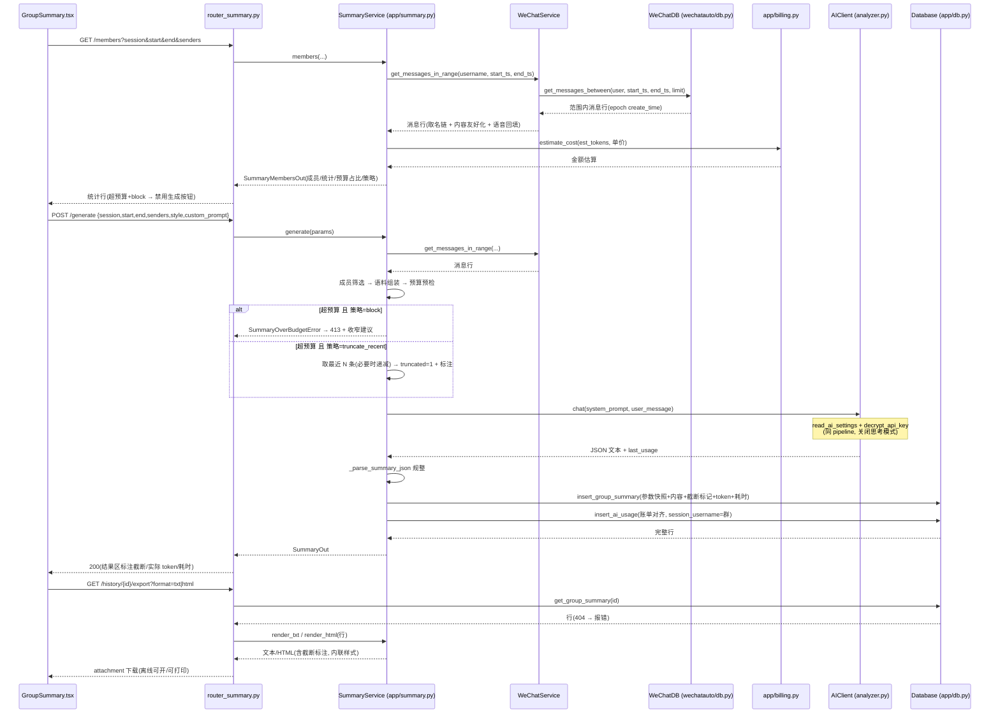
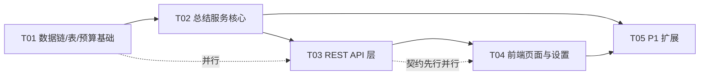

# 技术方案·群消息总结 2026-11-20（微信客服/商机监测系统）

依据：`docs/PRD-群消息总结-2026-11-20.md`（**已定稿**；产品决策全部确认：预算双口径、超限双策略、保留 6 个月且仅手动清理、定时默认每日 18:00、取消发送回群、三种风格不变）。技术栈不变：后端 FastAPI + 原生 sqlite3(WAL+RLock) + openai SDK（`app/`），前端 Vite + React18 + TS + MUI5（`frontend/src/`）。P0 = 选群 + 时间范围（跨天）+ 成员多选 + 风格 + 自定义提示词 → 预算预检 → AI 结构化总结 → 展示 + 导出 txt/html + group_summaries 历史管理；P1 = 定时自动总结（默认每日 18:00）、历史搜索、提示词模板。发送回群已取消，本方案不含任何发送链路。

---

## ① 实现方案与模块划分

### 1. 核心技术挑战与对策

| 挑战 | 对策 |
|------|------|
| WeChatDB 现有查询只有 `get_messages(user, limit, offset)`（sort_seq 倒序、无时间过滤），跨天大范围取消息靠分页回退效率差且无法提前终止 | **架构结论：允许在 `wechatauto/db.py` 新增只读方法 `get_messages_between(user, start_ts, end_ts, limit)`**（跨分片 `WHERE create_time BETWEEN`、sort_seq 升序归并，与 `get_messages` 同构，复用 `_run_msg_query`/`_msg_row_to_dict`）。理由：单方法、只读、无行为变更、回滚成本=删一个方法；若代码库_owner 明确冻结，则走等价降级：kefu 侧 `get_messages` 分页回退 + Python 时间过滤（大范围性能略差，见 ⑧） |
| 发送人名称必须与微信一致（备注→群显示名→群昵称→wxid） | 复用 `WeChatService._resolve_row_sender`（正文前缀权威解析 + `_get_group_member_names` 含 group_cards 学习缓存）；成员列表 `display_name` 走 `resolve_group_member_display` |
| 预算「按金额/按 token」双口径 + 超限策略可配 | 新增共享模块 `app/billing.py`（从 `router_system.py` 抽出 `_billing_settings`/`_usage_cost`，公式不变，避免预算预检与实际账单换算漂移）；`summary.py` 用字符数估算 prompt token（1 字符≈1 token 量级）+ 固定输出估值，按单价换算成金额，与配置口径对比；策略 `block`→413 阻止，`truncate_recent`→按最近 N 条回退并**显式标注** |
| AI 调用耗时数秒至数十秒 | 端点用普通 `def`（FastAPI 线程池，不阻塞事件循环，与现有路由一致）；前端 Loading 提示；超时沿用 `ai.timeout_sec` |
| 导出 HTML 需内联样式、离线可开/可打印 | 后端统一渲染 `render_txt/render_html`（单文件、零外链、内联 `<style>` + `@media print`，标准浅色一套）；前端直接下载响应流，保证页面与导出一致 |

### 2. 模块划分及理由

```
app/summary.py               ← 新增：总结域全部业务逻辑（纯服务层，无 HTTP/无全局单例）
app/billing.py               ← 新增：账单单价读取 + token→金额换算（从 router_system 抽出共享）
app/api/router_summary.py    ← 新增：薄路由（参数校验 → 调服务 → 组装响应）
frontend/src/pages/GroupSummary.tsx ← 新增：单页双 Tab（新建 / 历史）
```

切分逻辑与现有架构同构：`analyzer.py`（纯逻辑 + client_factory 注入替身）+ `router_analysis.py`（薄路由）+ `deps.py`（单例注入）。`SummaryService(db, wechat, client_factory=None)` 三处依赖全注入，模式照抄 `Pipeline._default_client_factory`；router 只做参数规整与异常翻译（超预算→413、AIError→502），服务层可独立单测。

不放进 `pipeline.py`：pipeline 是监听驱动 + 队列 + worker 的常驻链，总结是用户请求驱动、一次执行、允许同步等待的交互式操作，重试/日志/合规口径均不同。

`app/billing.py` 抽取原因：预算预检需要「token 估算 → 金额」换算，必须与 `GET /api/system/billing` 的**现有公式**（`per_k`/`per_m` 单价 + prompt/completion 分算）完全一致；直接 import `router_system._usage_cost` 会造成 service→api 反向依赖，复制一份又会漂移，故抽成无状态共享模块，`router_system.py` 改为 import 调用（行为零变化）。

### 3. 数据链与预算流程

```
前端 POST /api/summary/generate {session,start,end,senders,style,custom_prompt}
 → router_summary（def 端点）
  → SummaryService.generate()
   → WeChatService.get_messages_in_range(username, start_epoch, end_epoch, limit)  [新增]
     → WeChatDB.get_messages_between(...)  [新增] → 逐行复用取名链/content_format/语音缓存回填
   → 成员筛选(senders 空=全部) → 语料组装
   → 预算预检(billing.py 换算)：未超 → 直接生成；超 + block → 413；超 + truncate_recent → 取最近 N 条(必要时递减至预算内) → 打截断标记
   → AIClient.chat()（read_ai_settings + decrypt_api_key，同 pipeline._build_client）
   → _parse_summary_json() 规整
   → db.insert_group_summary()（参数快照 + 内容 + 截断标记 + token + 耗时）
   → db.insert_ai_usage()（账单对齐；ai_usage 不在清理白名单，永久保留）
   → 返回 SummaryOut
```

时间口径铁律：a) 业务库 TEXT 时间统一 `YYYY-MM-DD HH:MM:SS`（与 `datetime('now','localtime')` 同形）；b) 微信消息时间过滤走 epoch 秒（`datetime.strptime(s).timestamp()` 本地时区），SQL 内只有整数比较，**不存在** Python 拼 T 分隔字符串入 SQL 比较的路径；c) 前端 datetime-local 值 `T`→空格、补 `:00` 后提交；d) 保留时长清理复用现有 `db._PURGE_CUTOFF_SQL`（SQLite 自己算截断点），天然同格式。

---

## ② 文件列表

### 新增

| 文件 | 内容 |
|------|------|
| `app/summary.py` | 三档风格模板、Prompt 构造、语料组装、预算预检与截断、JSON 容错解析、`SummaryService`、`render_txt/render_html`、`SummaryScheduler`（P1） |
| `app/billing.py` | `get_billing_settings(db)` + `estimate_cost(prompt_tokens, completion_tokens, billing)`（从 router_system 抽出的同一公式） |
| `app/api/router_summary.py` | REST 路由：六个 P0 端点 + `GET/PUT /api/summary/settings`（设置页唯一配置通路：预算 5 键 + 定时 2 键），见 ③-3 |
| `frontend/src/pages/GroupSummary.tsx` | 双 Tab 页面（表单/预算统计行/结果/历史/导出/删除确认） |
| `tests/test_summary.py` | 服务层（注入替身）+ API（TestClient）用例 |
| `docs/sequence-diagram-群消息总结.mermaid`、`docs/class-diagram-群消息总结.mermaid` | ④ 图源码（不覆盖原系统级同名文件） |

### 修改

| 文件 | 改动点 |
|------|--------|
| `wechatauto/db.py` | 新增 `WeChatDB.get_messages_between`（只读、跨分片时间过滤 + 归并） |
| `app/wechat_service.py` | 新增 `get_messages_in_range(username, start_epoch, end_epoch, limit=5000) -> tuple[list[dict], str]`：调上者 + `_resolve_row_sender` + `content_format` + `_fill_voice_texts`；`_wxdb None` → `( [], MSG_DB_UNAVAILABLE_ERROR )` |
| `app/db.py` | ① DDL 追加 `group_summaries` + 2 索引（`CREATE TABLE IF NOT EXISTS`，老库启动即得）；② DAO `insert_group_summary`/`list_group_summaries`/`get_group_summary`/`delete_group_summary`；③ **`_PURGE_TABLES` 追加 `"group_summaries"`——它是「手动 purge 白名单」（供 `/api/system/purge` 的 dry_run 预览/真删/留痕复用），不是自动清理；系统没有、也不新增任何定时清理任务**（见 ⑦-9） |
| `app/config.py` | 新增 settings 键常量 + 默认值（预算口径/值/策略/N、定时开关/时间/按群配置、保留天数，见 ⑦-2） |
| `app/schemas.py` | 追加五个 summary 模型 + `SummarySettingsOut`/`SummarySettingsUpdate`（设置页配置通路）；`RetentionOut`/`RetentionUpdate` 追加 `summaries_days`；**`PurgeRequest.table` 正则由 `^(analysis_logs\|opportunities)$` 追加 `group_summaries`**（`schemas.py:277`，db.py:1253 白名单已含该表，漏改会导致设置页清理 422，端点代码零改动） |
| `app/billing.py`（新）见上；`app/api/router_system.py` | `_billing_settings`/`_usage_cost` 删除并改为引用 `app.billing`；`get_retention`/`update_retention` 增加 `retention.summaries_days`（默认 180，仅用于设置页统一展示/编辑，**不触发任何定时清理**） |
| `app/api/deps.py` | `get_summary_service() -> SummaryService`（请求级轻量构造） |
| `app/api/__init__.py` | 注册 `router_summary` 进 `ALL_ROUTERS` |
| `frontend/src/api/types.ts` | 追加与 schemas 对齐的 TS 接口；`Retention*` 类型加 `summaries_days` |
| `frontend/src/App.tsx` | Drawer 在**分析日志之前**加 `Summarize` 图标「群消息总结」→ `/summary`；Routes 注册；P1 定时产出 Badge |
| `frontend/src/pages/SettingsPage.tsx` | 新增「群消息总结配置区」：预算口径/预算值/超限策略/N、定时开关与时间+按群配置、保留时长 180 天（纳入现有统一保留管理 UI）；数据与账单 tab 的保留天数加 `summaries_days` |

不需要改：`app/main.py`（经 ALL_ROUTERS 自动挂载；**无**自动清理任务可改）、`app/analyzer.py`、`app/pipeline.py`、`frontend/src/api/client.ts`。**发送回群相关链路（Sender/SendTask）完全不涉及**。

---

## ③ 数据结构与接口

### 1. group_summaries 表 DDL（追加进 `DDL_STATEMENTS`）

```sql
CREATE TABLE IF NOT EXISTS group_summaries (
  id                     INTEGER PRIMARY KEY AUTOINCREMENT,
  session_username       TEXT NOT NULL,                -- 群 username（xxx@chatroom）
  session_name           TEXT NOT NULL,                -- 生成时群显示名快照
  time_start             TEXT NOT NULL,                -- 'YYYY-MM-DD HH:MM:SS'
  time_end               TEXT NOT NULL,
  msg_count              INTEGER NOT NULL DEFAULT 0,   -- 实际送入 AI 的消息条数（截断后为 N）
  member_count           INTEGER NOT NULL DEFAULT 0,   -- 范围内发言成员数（未筛选口径）
  sender_wxids           TEXT NOT NULL DEFAULT '[]',   -- 成员筛选快照 JSON 数组；'[]'=全部
  member_names           TEXT NOT NULL DEFAULT '',     -- 筛选成员显示名快照 JSON 数组（历史摘要用）
  style                  TEXT NOT NULL DEFAULT 'detailed'
                         CHECK (style IN ('detailed','concise','bullets')),
  custom_prompt          TEXT NOT NULL DEFAULT '',     -- ≤500 字原文
  content                TEXT NOT NULL,                -- 六节总结 JSON（下方结构）
  truncated              INTEGER NOT NULL DEFAULT 0,   -- 是否按最近 N 条截断
  truncated_original     INTEGER NOT NULL DEFAULT 0,   -- 截断前筛选结果消息数（0=未截断）
  model                  TEXT NOT NULL DEFAULT '',
  latency_ms             INTEGER,
  prompt_tokens          INTEGER,                      -- usage 快照（网关缺 usage 时为 NULL）
  completion_tokens      INTEGER,
  created_at             TEXT NOT NULL DEFAULT (datetime('now','localtime'))
);
CREATE INDEX IF NOT EXISTS idx_gs_created ON group_summaries (created_at DESC);
CREATE INDEX IF NOT EXISTS idx_gs_session ON group_summaries (session_username, created_at DESC);
```

`content` JSON（固定六节，风格只影响详略）：

```json
{"reminders":["…"],"topics":["…"],"comments":["…"],"followups":["…"],"others":["…"],"closing":"…"}
```

AI 调用失败不落库，错误经 API 返回、前端重试；历史表只存成功结果。

### 2. Pydantic Schema（`app/schemas.py` 追加）

```python
STYLE_VALUES = ("detailed", "concise", "bullets")   # detailed=全面 / concise=简洁 / bullets=要点式

class SummaryMemberItem(BaseModel):
    sender_wxid: str; display_name: str; count: int; chars: int

class SummaryMembersOut(BaseModel):
    items: List[SummaryMemberItem]   # 全量成员（用于多选），按发言条数倒序
    msg_count: int                   # senders 筛选后的消息数（未传 senders 即总数）
    char_count: int                  # 筛选后字符量
    est_prompt_tokens: int
    est_output_tokens: int = 2000    # 固定输出估值
    est_tokens: int                  # 两项之和
    est_cost: float                  # 按现有单价换算（元）
    budget_mode: str                 # money | tokens
    budget_value: float              # 用户配置的预算值（元 或 token 数）
    budget_text: str                 # 展示用：「¥1.00」/「60,000 tokens」
    usage_ratio: float               # est 值 / 预算值，0 表示未配置预算
    over_budget: bool
    action: str                      # block | truncate_recent
    truncate_n: int                  # 策略为截断时的 N
    budget_hint: str = ""            # 金额口径且单价未配置时回固定提示文案（前端原样展示）
    error: str = ""                  # 微信库不可读的中文原因

class SummaryGenerateIn(BaseModel):
    session: str = Field(min_length=1)
    start: str                                  # 'YYYY-MM-DD HH:MM:SS'
    end: str
    senders: List[str] = []                     # 空 = 全部成员
    style: str = "detailed"
    custom_prompt: str = Field(default="", max_length=500)

class SummaryOut(BaseModel):
    id: int; session_username: str; session_name: str
    time_start: str; time_end: str
    msg_count: int; member_count: int
    sender_wxids: str = "[]"; member_names: str = ""
    style: str; custom_prompt: str = ""
    content: str                                # JSON 字符串，前端解析后按小节渲染
    truncated: bool = False
    truncated_original: int = 0
    model: str = ""; latency_ms: Optional[int] = None
    prompt_tokens: Optional[int] = None; completion_tokens: Optional[int] = None
    created_at: str = ""

class SummaryListOut(BaseModel):
    total: int; items: List[SummaryOut]

class SummarySettingsOut(BaseModel):     # GET/PUT /api/summary/settings
    # 字段别名即 settings 键（响应保持点分键，与前端类型一一对应）
    budget_mode: str = Field(default="money", alias="summary.budget_mode")
    budget_money: str = Field(default="1.0", alias="summary.budget_money")
    budget_tokens: str = Field(default="60000", alias="summary.budget_tokens")
    over_limit_action: str = Field(default="block", alias="summary.over_limit_action")
    truncate_recent_n: str = Field(default="200", alias="summary.truncate_recent_n")
    schedule_enabled: str = Field(default="0", alias="summary.schedule_enabled")
    schedule_configs: str = Field(default="[]", alias="summary.schedule_configs")

class SummarySettingsUpdate(BaseModel):  # None=不变更；extra=forbid
    # 字段与别名同上，类型 Optional[str]
```

### 3. REST API（`app/api/router_summary.py`，prefix=`/api/summary`）

| 方法/路径 | 请求 | 响应 | 错误 |
|-----------|------|------|------|
| `GET /api/summary/members` | `session` + `start` + `end`（必填）；`senders` 可选（逗号分隔 wxid，空=全部，用于筛选后预算统计） | `SummaryMembersOut`（items 恒为全量成员；统计/预算字段按 senders 筛选） | 400 时间格式/区间非法；503 微信库不可读（`error` 字段中文原因） |
| `POST /api/summary/generate` | `SummaryGenerateIn` | `SummaryOut` | 400 无消息；413 超预算且策略=block（detail=「预估 X 已超预算 Y，请收窄范围或调整设置页预算/策略」）；502 AI 失败；503 库不可读 |
| `GET /api/summary/history?page=&page_size=&session=&date=` | 分页；session 精确、date=`YYYY-MM-DD`（历史搜索 P1） | `SummaryListOut` 时间倒序 | — |
| `GET /api/summary/history/{id}` | — | `SummaryOut` | 404「总结不存在」 |
| `DELETE /api/summary/history/{id}` | — | `{"ok": true}` | 404 |
| `GET /api/summary/history/{id}/export?format=txt\|html` | — | `PlainTextResponse`/`HTMLResponse`，`Content-Disposition` RFC5987 文件名 `群消息总结-<群名>-<起>至<止>.txt/html`；截断时正文顶部含统一文案「已截断：仅统计最近 N 条」（可附「（原共 M 条）」） | 404 / 400 format 非法 |
| `GET /api/summary/settings` | — | `SummarySettingsOut`（响应键为点分 settings 键） | — |
| `PUT /api/summary/settings` | `SummarySettingsUpdate`（None=不变更；未知键拒绝） | `SummarySettingsOut` | 422 非法枚举/数值范围/定时 JSON 非法/未知键 |

`GET/PUT /api/summary/settings` 是 T04 设置页配置区的**唯一通路**：现有 `router_settings.py` 全为专用端点（ai/analysis/monitor/image/server/notify/billing），没有通用键值读写接口。该端点在 `app/db.py` 的 `get_setting/set_setting` 上做白名单映射，读写**全部** `summary.*` 键——预算口径 `summary.budget_mode`、预算值 `summary.budget_money` / `summary.budget_tokens`、超限策略 `summary.over_limit_action`、截断条数 `summary.truncate_recent_n`、定时总开关 `summary.schedule_enabled`（默认 `0`，不打扰用户）与按群配置 `summary.schedule_configs`（JSON 数组，含 session/display_name/enabled/time，默认 `[]`，默认时间 18:00、每日一次）；写入时校验枚举、数值范围与定时 JSON，失败 422。P0 只保存定时配置，`SummaryScheduler` 不启动任何线程（T05 再接入调度执行）。

P1 增补（设置页 + 通知，非 P0）：

| 方法/路径 | 说明 |
|-----------|------|
| `GET/PUT /api/summary/schedules`（P1 可选语义封装） | 非必需：设置页配置已由 `/api/summary/settings` 覆盖；若做此端点仅转调同一 settings 读写函数。T05 在 settings 的定时配置上启动 daemon 线程，命中 HH:MM 且当日未产出时调用 `SummaryService.generate` + `notifier.broadcast("summary_new", …)` |
| `GET /api/system/retention`、`PUT /api/system/retention` | **已存在**，仅扩展 `summaries_days` 字段，使设置页保留时长统一管理**展示/编辑**口径一致（默认 180 天 = 6 个月） |
| `POST /api/system/purge` | **完全复用现有端点、零改动**：`_PURGE_TABLES` 已含 `group_summaries`，设置页「立即清理」选该表即走同一套 dry_run 预览/真删/`runtime.last_purge` 留痕；**不新增任何专用清理端点、DAO 或定时任务** |

### 4. 预算估算与截断规则（核心算法）

共享换算（`app/billing.py`，与现有账单同公式）：

```
divisor = 1000.0 if billing.unit == "per_k" else 1_000_000.0
est_cost = est_prompt_tokens / divisor * billing.input_price
         + est_output_tokens / divisor * billing.output_price
```
单价未配置（input/output 单价均为 0.0）时 `est_cost=0`，按金额口径的预算判断退化为「不超预算」。**必须由后端在预检响应中回 `budget_hint`，前端原样展示**，文案统一为：**「请先在设置页配置模型单价，否则金额预算不生效」**；设置页预算配置区同样标注此提示（当用户选择金额口径且单价为 0 时显示）。不允许静默按「不超预算」处理而不给用户提示。

- `est_prompt_tokens ≈ char_count`（中文 1 字符≈1 token 量级，标签明确写「预估」）；`est_output_tokens = 2000`（六节输出的固定估值）。
- 预算口径：`money` → `est_cost` vs `summary.budget_money`（元）；`tokens` → `est_tokens` vs `summary.budget_tokens`。`usage_ratio = est / budget`（budget≤0 视为未配置，ratio=0、`over_budget=False`）。
- 策略 `block`：超预算 → 413 + 收窄建议；`truncate_recent`：超预算 → 取筛选后**时间最近 N 条**（N=`summary.truncate_recent_n`），重算语料；若仍超预算，按 10% 递减 N 重试，N<10 仍超 → 413「无法在预算内生成」；落库 `truncated=1`、`truncated_original=原条数`、`msg_count=N`。**截断标注文案四处统一为「已截断：仅统计最近 N 条」**（结果区醒目条、txt 顶部、html 顶部、AI 语料首行；N 为实际保留条数，可在其后附「（原共 M 条）」补充信息，但主文案不得改写）。
- 生成成功后把**真实** `last_usage` 写入 ai_usage 与行内快照；页面顶部统计行显示预估值，结果区显示实际 token（两者可能不等，文案区分）。
- `get_messages_in_range` 的 limit（5000）只作病态输入兜底，不是预算手段；到达 limit 时按「数据过多」返回 413 并提示收窄（不静默截断）。

### 5. Prompt 设计（`app/summary.py`，语义在此锁定）

System Prompt（模板 + `format` 注入，正文不得出现未转义花括号，同 analyzer）：

```
你是微信群聊记录总结助手。请阅读下面的群聊记录，按要求输出固定六个部分的总结。
## 输出 JSON 格式
{"reminders": <string[]>, "topics": <string[]>, "comments": <string[]>, "followups": <string[]>, "others": <string[]>, "closing": <string>}
## 各部分定义
- reminders 重要提醒：需立即关注的事项（投诉、故障、紧急需求、明确商机线索）
- topics 热门话题：被反复讨论的主题，注明涉及成员
- comments 点评：对讨论内容的客观分析判断
- followups 待跟进事项：需后续跟进的具体行动项，必须注明相关成员名
- others 其他讨论：值得留意的其余内容
- closing 结语：一段话总览（不列点）
## 风格要求
{style_rules}     ← detailed=每节 4-6 条详述；concise=每节 2-3 条短句；bullets=每节短语级要点
{custom_block}    ← 非空时注入「## 补充要求（用户指定，优先满足）\n<原文>」
## 原则
1. 只基于聊天记录，不臆测；发言者名称以记录中的显示名为准。
2. 空节输出空数组 []，不要编造。
3. 只输出一个 JSON 对象，不要输出其他文字或 Markdown 代码块标记。
```

User Message：`群聊：{群名}\n时间范围：{start} ~ {end}\n成员筛选：{全部 | 仅 N 人：…}\n{截断提示（如有）}\n消息（共 {msg_count} 条，按时间正序）：\n{语料}`；语料行 `[MM-DD HH:MM] 显示名: 内容`。解析 `_parse_summary_json`：剥代码块 → `json.loads` → 正则兜底首个 `{...}` → 规整（数组去空、closing 兜底）→ 失败抛 `AIError` → 502。

---

## ④ 调用流程与结构图

### 时序图：预算预检 → 生成（含截断）→ 导出



### 类图（新增/扩展部分）

```mermaid
classDiagram
    class Database {
        +insert_group_summary(...) dict
        +list_group_summaries(page, page_size, session, date) (int, list)
        +get_group_summary(id) dict?
        +delete_group_summary(id) int
        +insert_ai_usage(...) int
        +_PURGE_TABLES: tuple
    }
    note for Database "_PURGE_TABLES 含 group_summaries：手动 purge 白名单，非自动清理"
    class WeChatService {
        +get_messages_in_range(username, start_epoch, end_epoch, limit) (list, str)
        -_resolve_row_sender(username, content, fallback_wxid, sender_id) (str, str)
        +resolve_group_member_display(chatroom, member_id) str
    }
    class WeChatDB {
        +get_messages_between(user, start_ts, end_ts, limit) List~dict~
        +get_messages(user, limit, offset) List~dict~
    }
    class Billing {
        +get_billing_settings(db) dict
        +estimate_cost(pt, ct, billing) float
    }
    class SummaryService {
        -db: Database
        -wechat: WeChatService
        -client_factory: Callable
        +members(session, start, end, senders) dict
        +generate(session, start, end, senders, style, custom_prompt) dict
        -build_system_prompt(style, custom_prompt) str
        -build_corpus(msgs, senders) (str, dict)
        -check_budget(stats) dict
        -parse_summary_json(text) dict
        +render_txt(row) str
        +render_html(row) str
    }
    class SummaryOverBudgetError
    class SummaryScheduler {
        +start() void
        -tick() void
    }
    class AIClient {
        +chat(system_prompt, user_message) str
        +last_usage: dict?
    }
    class RouterSummary {
        +GET /api/summary/members
        +POST /api/summary/generate
        +GET /api/summary/history
        +GET /api/summary/history/{id}
        +DELETE /api/summary/history/{id}
        +GET /api/summary/history/{id}/export
        +GET /api/summary/settings
        +PUT /api/summary/settings
    }
    SummaryService --> Database : 落库/用量
    SummaryService --> WeChatService : 取消息/取名链
    SummaryService --> Billing : 预算换算(与账单同公式)
    SummaryService --> AIClient : client_factory 构造并调用
    WeChatService --> WeChatDB : get_messages_between
    WeChatService ..> Database : group_cards/voice_texts 缓存
    RouterSummary ..> SummaryService : deps.get_summary_service()
    RouterSummary --> Database : get_db()
    SummaryService ..> SummaryOverBudgetError : 超预算(block)抛出→413
    SummaryScheduler ..> SummaryService : 定时 generate()
```

---

## ⑤ 任务列表（按依赖排序）

> pytest 一律 `/d/my_conda_envs/wechatauto/python.exe -m pytest --basetemp=D:/tmp/pt-summary-<子目录>`；前端改完 `npm run build`；后端改完重启 8766；版本号仅 `version.txt` + `tools/version_sync.py`。

### T01 数据链、表与预算基础（P0，可立即开工）
文件：`wechatauto/db.py`、`app/wechat_service.py`、`app/db.py`、`app/config.py`、`app/schemas.py`（PurgeRequest 正则）、`app/billing.py`、`app/api/router_system.py`、`tests/test_summary.py`（起步）
1. `wechatauto/db.py`：`get_messages_between`（各分片 WHERE create_time 过滤 → sort_seq 升序归并 → 截 limit）。
2. `app/wechat_service.py`：`get_messages_in_range`（调上者 + `_resolve_row_sender` + `content_format` + `_fill_voice_texts`；库不可用返回中文原因）。
3. `app/db.py`：DDL（含 `truncated`/`truncated_original`）+ 2 索引；DAO 四方法；**`_PURGE_TABLES` 追加 `"group_summaries"`——它是手动 purge 白名单（复用现有 `count_older_than`/`delete_older_than`/`purge_cutoff`/留痕），不是自动清理；系统无定时清理任务**。
4. `app/config.py`：settings 常量与默认值（见 ⑦-2）。
5. `app/billing.py`：抽出 `get_billing_settings`/`estimate_cost`；`router_system.py` 改为引用，删除本地副本（`_usage_cost` 调用点换名即可，行为不变）。
6. `app/api/router_system.py`：`get_retention`/`update_retention` 增 `summaries_days`（默认 180 天，仅设置页展示/编辑）；`POST /api/system/purge` 零改动。
7. `app/schemas.py`：`PurgeRequest.table` 正则追加 `group_summaries`（`schemas.py:277`；仅前端校验层，db.py:1253 白名单已含），否则设置页清理该表会被 422 拒绝。
8. 用例：建表幂等、DAO 增删查、`count_older_than("group_summaries", days)` / `delete_older_than("group_summaries", days)` 按截断点正确统计/删除、**`PurgeRequest(table="group_summaries", ...)` 校验通过（正则断言）**、`get_messages_between` 时间过滤/归并、billing 公式与旧实现一致性。
依赖：无。**与 T02 Prompt/预算算法设计、T03 schema 草案可并行。**

### T02 总结服务核心（P0）
文件：`app/summary.py`、`tests/test_summary.py`（补用例）
1. 常量：风格三档文案、`STYLE_VALUES`、输出估值 2000。
2. `build_system_prompt` / `build_user_message`（花括号转义、截断提示注入）。
3. `build_corpus(msgs, senders)`：成员筛选、语料行、返回 (corpus, stats)。
4. 预算：`check_budget(stats)`（读 settings money/tokens 口径、billing 换算、`usage_ratio`、`over_budget`）；`apply_truncate(msgs, n, stats)`（取最近 N、按 10% 递减重试、输出截断标记）。
5. `_parse_summary_json`：剥代码块 → JSON → 正则兜底 → 规整 → AIError。
6. `SummaryService.__init__(db, wechat, client_factory=None)`（默认工厂同 `Pipeline._default_client_factory`）。
7. `members(...)`：时间字符串→epoch → 取消息 → 聚合成员（按 sender_wxid，显示名走取名链）→ 应用 senders 筛选 → 预算字段（含 `budget_hint`：money 口径且单价未配置时回填「请先在设置页配置模型单价，否则金额预算不生效」）。
8. `generate(...)`：校验 → 语料 → 预算预检（block→`SummaryOverBudgetError`；truncate→按统一文案标注）→ `AIClient.chat` → 解析 → `insert_group_summary` + `insert_ai_usage`。
9. `render_txt`/`render_html`：参数摘要 + 六节 + 统一截断文案「已截断：仅统计最近 N 条」；HTML 内联浅色样式 + `@media print`；`html.escape` 防注入。
10. 用例：注入 FakeChat 覆盖全链路、预算双口径换算、两种超限策略（含递减至预算内）、解析兜底、导出断言。
依赖：T01。

### T03 REST API 层（P0）
文件：`app/schemas.py`、`app/api/router_summary.py`、`app/api/deps.py`、`app/api/__init__.py`、`tests/test_summary.py`（API 用例）
1. schemas：③-2 五个 summary 模型 + `SummarySettingsOut`/`SummarySettingsUpdate` + Retention 追加字段（`PurgeRequest.table` 正则的追加归 T01）。
2. `deps.get_summary_service()`。
3. 六个 P0 端点 + `GET/PUT /api/summary/settings`（settings 白名单读写全部 summary.* 键：预算口径/两预算值/策略/N + 定时开关与按群配置；枚举、范围与定时 JSON 校验失败 422；P0 只保存定时配置不调度）；时间 `strptime` 校验（400）；异常映射 400/404/413/422/502/503；导出响应头 RFC5987 文件名。
4. `ALL_ROUTERS` 注册（重启 8766）。
5. TestClient 用例：全分支状态码、截断标注透传、导出头断言、**settings GET/PUT 往返与非法值 422**；清理相关由 T01 的 DAO/正则用例覆盖。
依赖：T02（schema 定稿后可与 T04 契约并行联调）。

### T04 前端页面与设置（P0）
文件：`frontend/src/pages/GroupSummary.tsx`、`frontend/src/pages/SettingsPage.tsx`、`frontend/src/api/types.ts`、`frontend/src/App.tsx`
1. `types.ts`：与 schemas 对齐（含预算字段、`truncated`、`summaries_days`、`SummarySettingsOut/Update`）；设置页读写统一走 `/api/summary/settings`。
2. `GroupSummary.tsx`：
   - Tabs 新建/历史；Drawer **分析日志之前**入口。
   - 表单：群 Autocomplete（复用 `GET /api/sessions/search?kind=group`）；起止时间两个 `TextField type="datetime-local"`（**不引 x-date-pickers**；默认今天 00:00-now；提交前 T→空格+`:00`）；成员多选 Autocomplete（选项「成员名（N 条）」，全选/清空，群/时间变化防抖 500ms 重查 members）；风格 ToggleButtonGroup；自定义提示词 multiline（≤500 字计数）。
   - 统计行：`X 条消息 / Y 位成员，预估 token ≈ Z，占预算 P%（¥A / B tokens；当前策略：阻止生成 / 最近 N 条截断）`；0 条或超预算+block 禁用生成 + 文案；策略/预算从设置页读取，切换后实时更新；`budget_hint` 非空时（金额口径未配单价）在统计行以警示色**原样显示**「请先在设置页配置模型单价，否则金额预算不生效」。
   - 生成：useMutation + Loading + 失败 Snackbar 重试；成功滚动结果区；结果区六节 h6+列表、信息条（时间/耗时/实际 token）、截断醒目条（统一文案「已截断：仅统计最近 N 条」）、导出 txt/html、重新生成。**结果区无「发送到群」按钮（用户定稿取消）**。
   - 历史 Tab：Table + Pagination（群名/日期筛选框）；列（生成时间/群名/时间范围/成员摘要/风格/token）；行点击只读详情 Dialog；删除二次确认。
3. `SettingsPage.tsx`：新增「群消息总结配置区」（预算口径切换 + 金额值默认 1.0 元 / token 值默认 60000、超限策略默认 block + N 默认 200、定时总开关**默认关** + 触发时间**默认 18:00** 可调整 + 按群配置；**金额口径且单价未配置时显示提示「请先在设置页配置模型单价，否则金额预算不生效」**）；数据与账单 tab 保留时长增加 summaries（默认 180 天 / 6 个月），「立即清理」直接复用现有 `/api/system/purge`（选 `group_summaries` 表，原有 dry_run 预览 + 确认 + 留痕流程不变），文案注明仅手动、不自动清理。
4. `App.tsx`：Drawer「分析日志之前」入口/路由 + P1 Badge 位。
5. `npm run build` 通过。
依赖：T03 契约（可按本文 ③ 先行开发）。

### T05 P1 扩展（P0 验收后；内部三项可并行）
文件：`app/summary.py`、`app/main.py`、`app/api/router_summary.py`、`frontend/src/pages/GroupSummary.tsx`、`frontend/src/pages/SettingsPage.tsx`
1. **定时自动总结**：`SummaryScheduler`（daemon 线程，每分钟检查：总开关 `summary.schedule_enabled`（默认**关**）+ 按群配置 `summary.schedule_configs`（触发时间默认 **18:00**、每日一次、可调），命中当前 HH:MM 且当日未产出则调用 `SummaryService.generate`（默认风格、默认预算策略）→ 落库 + `notifier.broadcast("summary_new", {id, session_name, created_at})`）；`main.py` lifespan 启停；前端 WS 事件 → 历史 Tab Badge。
2. **历史搜索与筛选**：后端 history 端点已带 session/date 参数；前端补搜索框/日期选择器。
3. **提示词模板管理**：settings `summary.prompt_templates` JSON 数组（增删/恢复默认），表单下拉选用 + 简单管理 UI。
依赖：T02、T03、T04。**发送回群已取消，不纳入本任务。**

### 任务依赖图



---

## ⑥ 依赖包列表（确认：无新增）

后端 requirements.txt 不变（fastapi/uvicorn/pydantic/openai/cryptography/sherpa-onnx/numpy/pytest 全现有）；`app/billing.py` 只是现有代码的重新组织。前端 package.json 不变：时间选择用原生 `TextField type="datetime-local"`，不引 `@mui/x-date-pickers`；历史列表用现有 `Table`，不引 `@mui/x-data-grid`（MUI5 `Autocomplete/ToggleButtonGroup/Tabs` 已在 `@mui/material@^5.16.7` 内）。

---

## ⑦ 共享知识（跨文件约定）

1. **取名链**：消息行显示名一律走 `WeChatService._resolve_row_sender`；成员下拉显示名走 `resolve_group_member_display`。不另起实现。
2. **token 计量对齐**：AI 调用只经 `AIClient.chat()`（`last_usage` 副作用）；成功双写 `group_summaries` 行内快照 + `db.insert_ai_usage()`（账单唯一数据源，`session_username`=群 username；ai_usage 不在清理白名单，永久保留）。usage 缺失时行内存 NULL、不写 ai_usage。预估算与真实用量文案区分。
3. **预算换算单一真源**：金额换算只用 `app.billing.estimate_cost`（`per_k`/`per_m` + input/output 分算），与 `/api/system/billing` 同公式；单价未配置时金额口径不触发超预算，但必须由后端预检回 `budget_hint`、前端与设置页原样展示固定文案「请先在设置页配置模型单价，否则金额预算不生效」，不得静默。
4. **settings 键名（字符串存表）**：`summary.budget_mode`=`money|tokens`（默认 `money`）；`summary.budget_money`（默认 `1.0` 元）；`summary.budget_tokens`（默认 `60000`）；两值分开存，切换口径无需换算；`summary.over_limit_action`=`block|truncate_recent`（默认 `block`）；`summary.truncate_recent_n`（默认 `200`）；`summary.schedule_enabled`（默认 `0`）；`summary.schedule_configs`（JSON 数组，含 `session/display_name/enabled/time`，默认 `[]`，默认时间 `18:00`，每日一次）；`summary.prompt_templates`（P1，默认 `[]`）；`retention.summaries_days`（默认 `180`）。
5. **时间口径铁律**：业务库 TEXT 时间空格分隔；「与现在比」的 SQL 只用 SQLite 时间函数；微信消息按 epoch 秒过滤；前端 datetime-local 的 T 在提交前转换。
6. **错误响应格式**：`{"detail": "<中文>"}`（client.ts 已统一解析）；400 参数/无消息、404 不存在、413 超预算(block)、422 配置值/清理表名校验失败、502 AI 失败、503 微信库不可读。
7. **截断语义**：`truncated=1` 必须同时写 `truncated_original`；**统一标注文案「已截断：仅统计最近 N 条」**（可后附「（原共 M 条）」），结果区、txt、html、AI 语料首行四处一致，不得各自改写。
8. **HTML 导出安全**：动态文本先 `html.escape` 再渲染；内联样式 + `@media print`；浅色一套。
9. **清理（用户定稿：仅手动，与别的数据完全一致）**：系统**无自动清理**（main.py 已移除 03:30 任务），也不得新增任何定时任务。**`_PURGE_TABLES` 是「手动 purge 白名单」而非自动清理配置**——将 `group_summaries` 追加进该白名单后，设置页「立即清理」选该表即完全复用现有 `POST /api/system/purge`：dry_run 预览、`db.purge_cutoff()` 按 SQLite 本地时间算截断点（绝不用 Python 时间字符串比较）、真删、`runtime.last_purge` 留痕，与其它两张表零差异；不新增任何专用端点、DAO 或留痕机制。保留天数 `retention.summaries_days` 默认 180（6 个月），通过现有 `/api/system/retention` 做统一展示/编辑，真删必须用户点击确认。
10. **构建/验证**：前端 `npm run build`；后端重启 8766；pytest conda + 独立 basetemp；版本号唯一真源 `version.txt`。

---

## ⑧ 技术开放点结论与 PRD 决策对齐

**开放点结论（架构拍板）**：采用 `wechatauto/db.py` 新增只读 `get_messages_between` 作为首选实现——它与现有 `get_messages` 同构、零行为变更、回滚成本极低，且大范围跨天查询在 SQL 侧完成时间过滤，性能与内存都远优于分页回退。降级方案（kefu 侧 `get_messages` 分页 + Python 过滤，限制分页深度并记日志，功能等价但性能略差）已在本方案中保留为实现分支的兜底说明；开工前工程师只需确认该库是否冻结，若冻结直接走降级，无需再改本方案其它部分。

**PRD 定稿决策对齐清单**：①发送回群取消——全文无 Sender/SendTask/发送端点设计，前端结果区无发送按钮，T05 仅含定时+搜索+模板；②入口在「分析日志之前」的 Drawer（路由 `/summary` 不变）；③定时默认每日 18:00、每日一次、时间可配、可开关，配置存 settings（总开关默认关，遵循不打扰用户原则），SummaryScheduler 按此实现；④预算双口径（金额/token）+ 自动换算 + 双超限策略（block→413 / truncate_recent→最近 N 条标注截断，N 可配）+ 预检返回占比与策略（config.py/schemas/members 响应/时序图均已调整）；⑤保留 6 个月、仅手动清理：**`group_summaries` 加入 `_PURGE_TABLES`（手动 purge 白名单，不是自动清理配置），完全复用现有 `/api/system/purge` 的预览/删/留痕流程**，保留天数走 `/api/system/retention`，不新增任何专用清理机制（见 ⑦-9）；⑥HTML 仅标准浅色一套 + 打印友好；⑦风格三种不变。产品侧最终补充的两条 UI 边界（金额口径未配单价的提示文案、四处统一截断文案）已写入 ③-4/⑦-3/⑦-7 与 T02/T04；产品侧无待确认问题，以上为定稿。

**实现通路补齐（非产品语义变更）**：①新增 `GET/PUT /api/summary/settings`，作为设置页读写全部 `summary.*` 键（预算口径/预算值/策略/N + 定时开关与按群配置）的唯一通路——现有 `router_settings.py` 均为专用端点、无通用键值接口；`/api/summary/schedules` 留作 P1 可选语义封装，T01–T04 不实现。②`app/schemas.py` 的 `PurgeRequest.table` 正则追加 `group_summaries`（db.py 白名单已含），否则手动清理该表会被 422 拒绝；`/api/system/purge` 端点代码零改动。预算/定时/清理语义均不变。

**保留的技术侧开放点（非产品决策）**：`wechatauto/db.py` 是否允许新增只读 `get_messages_between`——首选此方案（见上文结论），若该库冻结则退化为 kefu 侧分页 + Python 时间过滤（功能等价、大范围性能略差），工程师开工前确认即可，不需要产品再拍板。
