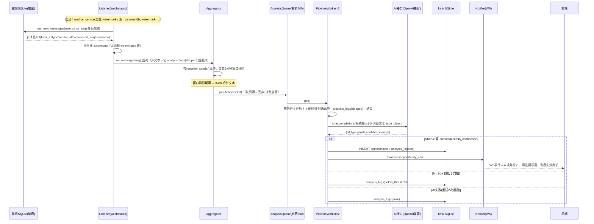
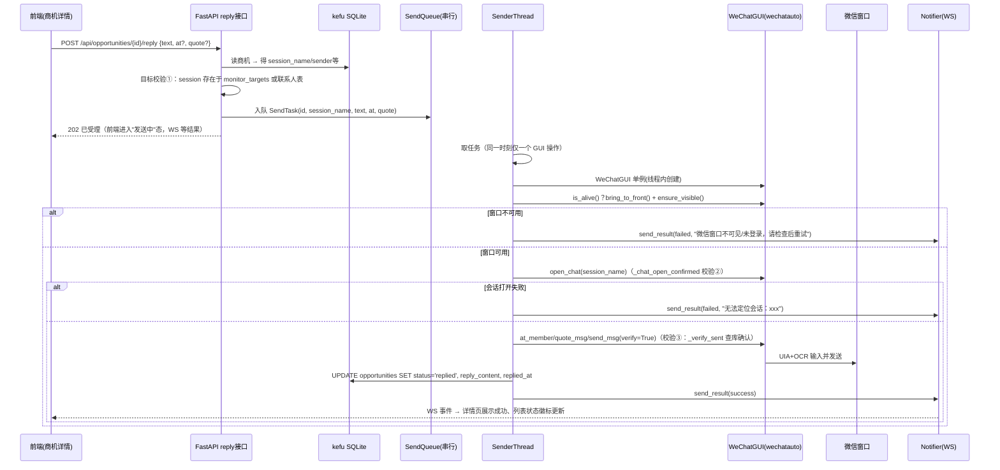

# 技术方案与任务分解：微信商机监测与客服系统（kefu-system）

> 产出：架构师 高见远（software-architect）· 2026-11-02
> 输入：`docs/PRD-微信商机监测与客服系统.md` + 已确认产品决策 10 条
> 硬约束：新增代码全部在 `kefu-system/` 内，只调用不修改 `wechatauto/` 与 `adapter/`

---

## 1. 实现方案与框架选型

### 1.1 核心技术挑战

| 挑战 | 对策 |
|---|---|
| 上百会话实时监听，AI 调用慢，不能阻塞监听 | 复用 `wechatauto.db.Listener`（其内部已做"轮询线程 + 每会话串行工作线程"），我们的回调只做**入队**，秒级返回 |
| 同会话同发送人 5 分钟窗口合并（先攒后析） | 进程内 **Aggregator**：按 `(session, sender)` 维护缓冲区 + 过期调度线程，窗口静默期满后作为一条"分析单元"进入分析队列 |
| 分析吞吐有界、不雪崩 | **有界队列**（maxsize=500，满则丢弃并计数告警）+ **固定 worker 池**（默认 2 线程）+ AI 调用信号量限流 + 失败指数退避重试 2 次 |
| 成本控制 | 可选**轻量预筛**：关键词/正则粗筛，未命中不进 AI（全局开关），未命中记录进 analysis_logs |
| GUI 发送不可并发、需窗口前置 | 独立 **Sender 线程**串行消费发送队列：`bring_to_front → ensure_visible → open_chat(三重校验) → send_msg(verify=True 数据库确认)`；失败映射为明确中文错误 |
| Key 不落明文 | `cryptography.Fernet`，密钥文件 `kefu-system/data/secret.key` 首次运行自动生成，API Key 密文存 SQLite，接口只回掩码 |
| 前端实时性 | FastAPI 原生 **WebSocket** 推送事件（新商机/状态变化），前端 WS 订阅 + 断线自动重连 + 轮询降级 |

### 1.2 框架选型与理由

**后端：Python 3.10+ / FastAPI + Uvicorn + 原生 sqlite3（WAL 模式）**

- FastAPI：单进程本机应用，天然支持 WebSocket、Pydantic 校验、自动 API 文档；Uvicorn 单 worker 与 GUI 自动化线程模型兼容（无多进程复制问题）。
- **SQLite 选原生 `sqlite3` 而非 SQLAlchemy**：表仅 6 张、单机单写者、无迁移演进需求；ORM 反而引入连接池/线程模型复杂度。采用 `check_same_thread=False` + 单写锁（`threading.RLock`）+ WAL 模式，DAO 层集中管理，风险可控、零额外依赖。
- wechatauto 复用方式：`WeChatDB`（消息/联系人/群成员查询）、`Listener`（新消息回调 + watermark）、`wechatauto.guia.WeChatGUI`（发消息）。全部只 import 调用。

**AI 调用：openai 官方 SDK（`openai>=1.x`）**

- 理由：v1 SDK 支持 `base_url` 覆盖（直连任意 OpenAI 兼容网关）、原生超时/重试控制、`response_format={"type":"json_object"}` 便于结构化输出；市面兼容网关（DeepSeek/通义/OneAPI 等）对 openai SDK 的兼容度高于裸 httpx 手写协议。自建重试/退避在 SDK 外层做，便于记录 analysis_logs。
- 备选 httpx 不选的原因：需手写鉴权、错误分类、JSON 提取，代码量更大且收益低。

**前端：Vite + React 18 + MUI 5（构建产物由 FastAPI StaticFiles 托管）**

- 论证更轻的 Jinja2 + HTMX 方案：本应用需要——实时未读角标、列表筛选/分页、详情抽屉内的上下文懒加载、@群成员多选、设置页多表单即时校验。HTMX 做局部刷新可行但 WS 事件驱动 UI、客户端状态（筛选条件 × WS 增量合并）会迅速复杂化；React 的状态模型与组件复用（列表/详情/设置三页共享类型与 hooks）长期更省。
- MUI 提供完整桌面密度组件（DataGrid 可选、Drawer、Badge、Snackbar），贴合"本地控制台"形态。
- 数据层用 `@tanstack/react-query`：WS 推新商机时 `invalidateQueries` 即可增量刷新，避免手写缓存。
- 不引入 Tailwind（MUI 自带 sx/theme 足够），控制依赖。

**架构模式**：分层单体——`微信接入层（Listener）→ 领域管线层（Aggregator/Pipeline/Analyzer）→ 服务层（DAO/Notifier/Sender）→ API 层（FastAPI Routers）→ SPA 前端`。进程内单向数据流，所有状态落在 SQLite，重启可恢复（watermark 持久化保证不重复推送）。

---

## 2. 文件列表（kefu-system/ 下相对路径）

```
kefu-system/
├── requirements.txt              # 新增 Python 依赖清单
├── run.py                        # 启动入口：uvicorn 启动 FastAPI（生命周期内拉起监听与 worker）
├── app/
│   ├── __init__.py
│   ├── config.py                 # 路径常量（data 目录/secret.key/前端 dist）、合并窗口 300s 等常量
│   ├── db.py                     # SQLite 连接管理(WAL+写锁)、DDL 初始化、全部 DAO 函数
│   ├── crypto.py                 # Fernet 密钥管理 + API Key 加解密 + 掩码
│   ├── schemas.py                # Pydantic 请求/响应模型
│   ├── wechat_service.py         # WeChatDB/Listener 单例封装：启停、状态查询、watermark 持久化加载
│   ├── aggregator.py             # 5 分钟合并窗口：按(会话,发送人)缓冲，到期 flush 出"分析单元"
│   ├── analyzer.py               # AI 客户端(openai SDK)、Prompt 构造(三档严格度)、JSON 解析、预筛
│   ├── pipeline.py               # 有界分析队列 + worker 池 + 重试 + 落库 + 触发通知
│   ├── notifier.py               # WebSocket 连接管理器：事件广播(新商机/状态/角标清零)
│   ├── sender.py                 # GUI 发送服务：独立线程串行队列、窗口前置、三重校验、错误映射
│   ├── main.py                   # FastAPI app 工厂：路由注册、lifespan、静态托管前端 dist、异常处理
│   └── api/
│       ├── __init__.py           # 汇总各 router
│       ├── router_system.py      # /api/status、/api/sessions/search、/api/messages/{username}
│       ├── router_targets.py     # /api/monitor-targets CRUD
│       ├── router_types.py       # /api/opportunity-types CRUD
│       ├── router_settings.py    # /api/settings/ai、/api/settings/analysis、AI 测试连接
│       └── router_opportunities.py # /api/opportunities 列表/详情/上下文/状态/回复
├── frontend/
│   ├── package.json              # 前端依赖
│   ├── vite.config.ts            # dev 代理 /api、/ws → 127.0.0.1:8765；build.outDir=dist
│   ├── tsconfig.json
│   ├── index.html
│   └── src/
│       ├── main.tsx              # React 入口 + QueryClient + Router
│       ├── App.tsx               # 全局框架：左侧导航、WS 事件接入、全局状态横幅
│       ├── theme.ts              # MUI 主题（紧凑桌面密度）
│       ├── api/client.ts         # fetch 封装（统一错误）
│       ├── api/types.ts          # 与后端 schemas 对齐的 TS 类型
│       ├── hooks/useEvents.ts    # WS 订阅 + 自动重连 + react-query 失效联动
│       ├── pages/OpportunityList.tsx   # 商机列表：筛选栏、未读角标、行内快捷操作
│       ├── pages/OpportunityDetail.tsx # 商机详情抽屉：原文/要点/上下文/回复框/操作
│       ├── pages/SettingsPage.tsx      # 设置页：监控对象/商机类型/AI接口 三 tab
│       └── pages/MessageBrowse.tsx     # 消息浏览简化版（P0 只读）
└── docs/
    ├── PRD-微信商机监测与客服系统.md
    ├── 技术方案与任务分解.md      # 本文件
    ├── sequence-diagram.mermaid
    └── class-diagram.mermaid
```

---

## 3. 数据结构

### 3.1 SQLite 表结构（DDL）

```sql
-- 键值设置（AI 接口配置、判定档位、预筛、通知等；api_key 存 Fernet 密文）
CREATE TABLE IF NOT EXISTS settings (
  key        TEXT PRIMARY KEY,
  value      TEXT NOT NULL,
  updated_at TEXT NOT NULL DEFAULT (datetime('now'))
);

-- 监控对象
CREATE TABLE IF NOT EXISTS monitor_targets (
  id           INTEGER PRIMARY KEY AUTOINCREMENT,
  username     TEXT NOT NULL UNIQUE,          -- 会话 wxid（群 xxx@chatroom / 好友 wxid）
  display_name TEXT NOT NULL,                 -- 群名/好友昵称快照
  kind         TEXT NOT NULL CHECK (kind IN ('group','friend')),
  enabled      INTEGER NOT NULL DEFAULT 1,
  created_at   TEXT NOT NULL DEFAULT (datetime('now'))
);

-- 商机类型（自然语言描述）
CREATE TABLE IF NOT EXISTS opportunity_types (
  id          INTEGER PRIMARY KEY AUTOINCREMENT,
  name        TEXT NOT NULL,
  description TEXT NOT NULL,
  enabled     INTEGER NOT NULL DEFAULT 1,
  created_at  TEXT NOT NULL DEFAULT (datetime('now')),
  updated_at  TEXT NOT NULL DEFAULT (datetime('now'))
);

-- 商机（合并窗口产出的分析单元命中后生成）
CREATE TABLE IF NOT EXISTS opportunities (
  id               INTEGER PRIMARY KEY AUTOINCREMENT,
  session_username TEXT NOT NULL,
  session_name     TEXT NOT NULL,
  sender_wxid      TEXT NOT NULL DEFAULT '',
  sender_name      TEXT NOT NULL,             -- 群内昵称（私聊=对方昵称）
  window_start     TEXT NOT NULL,             -- 合并窗口首条消息时间 ISO8601
  window_end       TEXT NOT NULL,
  merged_count     INTEGER NOT NULL DEFAULT 1,
  raw_text         TEXT NOT NULL,             -- 合并后全文（每行"[HH:MM] 内容"）
  type_id          INTEGER REFERENCES opportunity_types(id) ON DELETE SET NULL,
  type_name        TEXT NOT NULL,             -- 命中类型名快照
  summary          TEXT NOT NULL,             -- AI 需求要点（换行拼接）
  key_quote        TEXT NOT NULL DEFAULT '',  -- 关键原文摘录
  confidence       INTEGER NOT NULL DEFAULT 0,
  status           TEXT NOT NULL DEFAULT 'pending'
                   CHECK (status IN ('pending','replied','ignored')),
  reply_content    TEXT,
  replied_at       TEXT,
  created_at       TEXT NOT NULL DEFAULT (datetime('now'))
);
CREATE INDEX IF NOT EXISTS idx_opp_created ON opportunities (created_at DESC);
CREATE INDEX IF NOT EXISTS idx_opp_status  ON opportunities (status);
CREATE INDEX IF NOT EXISTS idx_opp_session ON opportunities (session_username);

-- 分析日志（含 AI 失败/预筛跳过/低于门槛等全量记录，用于排查与成本审计）
CREATE TABLE IF NOT EXISTS analysis_logs (
  id               INTEGER PRIMARY KEY AUTOINCREMENT,
  session_username TEXT NOT NULL,
  sender_wxid      TEXT,
  msg_count        INTEGER NOT NULL,
  input_text       TEXT,
  result           TEXT,                      -- JSON: {hit,type,points,confidence,quote}
  status           TEXT NOT NULL
                   CHECK (status IN ('ok','error','skipped','below_threshold')),
  error            TEXT,
  model            TEXT,
  latency_ms       INTEGER,
  opportunity_id   INTEGER REFERENCES opportunities(id),
  created_at       TEXT NOT NULL DEFAULT (datetime('now'))
);

-- watermark 持久化（Listener 启动时读入，停止/定期刷回，保证重启不重复推送）
CREATE TABLE IF NOT EXISTS watermarks (
  username   TEXT PRIMARY KEY,
  sort_seq   INTEGER NOT NULL,
  updated_at TEXT NOT NULL DEFAULT (datetime('now'))
);
```

**settings 关键配置键（共享约定）**：

| key | 示例值 | 说明 |
|---|---|---|
| `ai.base_url` | `https://api.deepseek.com/v1` | OpenAI 兼容地址 |
| `ai.api_key_enc` | `gAAAAA...` | Fernet 密文 |
| `ai.model` | `deepseek-chat` | 模型名 |
| `ai.timeout_sec` | `60` | 超时 |
| `ai.temperature` | `0.2` | 温度 |
| `analysis.strictness` | `balanced` | lenient/balanced/strict |
| `analysis.min_confidence` | `60` | 0–100 最低置信度门槛 |
| `analysis.prescreen_enabled` | `0` | 预筛开关 |
| `analysis.prescreen_keywords` | `采购,求购,报价,加工` | 逗号分隔关键词 |
| `analysis.prescreen_regex` | *(空)* | 可选正则 |
| `analysis.merge_window_sec` | `60` | 分析微窗口：发送人静默 N 秒即触发 AI 分析（10–600） |
| `analysis.opp_merge_window_sec` | `180` | 商机合并窗口：同一人 N 秒内再次命中合并为一条（30–1800） |
| `notify.sound_enabled` | `0` | 提示音 |
| `compliance.confirmed` | `1` | 合规知情确认（P0-合规） |

### 3.2 REST API 路由表

统一约定：错误统一 HTTP 状态码 + `{"detail": "中文错误说明"}`；时间字段 ISO8601 字符串。

| 方法 | 路径 | 说明 | 请求体 / 响应 |
|---|---|---|---|
| GET | `/api/status` | 运行状态（顶部横幅） | → `{listener_running, monitored_count, wechat:{alive,visible}, queue:{size,max,dropped_total}, worker:{busy,max}, ai_configured, watermark_saved_at}` |
| GET | `/api/sessions/search?keyword=&limit=20` | 会话搜索（群+好友，复用 search_contact/get_sessions） | → `[{username, display_name, kind}]` |
| GET | `/api/monitor-targets` | 已配置监控对象 | → `[{id, username, display_name, kind, enabled}]` |
| POST | `/api/monitor-targets` | 新增并即时注册监听 | `{username}` → 目标对象 |
| PATCH | `/api/monitor-targets/{id}` | 启用/停用（联动 Listener 增删回调） | `{enabled}` |
| DELETE | `/api/monitor-targets/{id}` | 删除 | 204 |
| GET | `/api/opportunity-types` | 类型列表 | → `[{id,name,description,enabled,updated_at}]` |
| POST | `/api/opportunity-types` | 新增 | `{name, description, enabled?}` |
| PATCH | `/api/opportunity-types/{id}` | 修改/启停（后续消息生效） | `{name?, description?, enabled?}` |
| DELETE | `/api/opportunity-types/{id}` | 删除 | 204 |
| GET | `/api/settings/ai` | AI 配置（Key 掩码） | → `{base_url, api_key_masked, model, timeout_sec, temperature}` |
| PUT | `/api/settings/ai` | 保存（Key 留空则不变更） | `{base_url, api_key?, model, timeout_sec, temperature}` |
| POST | `/api/settings/ai/test` | 测试连接（发 1 条最小补全） | → `{ok, message, latency_ms, model}` |
| GET/PUT | `/api/settings/analysis` | 判定档位/门槛/预筛/合并窗口 | `{strictness, min_confidence, prescreen_enabled, prescreen_keywords, prescreen_regex, merge_window_sec}` |
| PUT | `/api/settings/notify` | `{sound_enabled}` | 提示音开关 |
| GET | `/api/opportunities?page=&page_size=20&session=&type_id=&status=&keyword=` | 商机列表（时间倒序） | → `{total, items:[{id, type_name, session_name, sender_name, sender_wxid, window_end, summary, confidence, status}]}` |
| GET | `/api/opportunities/{id}` | 详情（并清除该条未读） | → 完整字段 + `context:[消息dict]`（前后各 N=5 条，复用 `db.get_messages`） |
| PATCH | `/api/opportunities/{id}` | 标记状态 | `{status: "ignored"|"pending"|"replied"}` |
| POST | `/api/opportunities/{id}/reply` | 人工回复 | 请求示例见下 |
| GET | `/api/messages/{username}?before_seq=&limit=50` | 会话历史消息（详情上下文/消息浏览页复用） | → `[{local_id, type, type_name, sender_id, create_time, content, sort_seq}]` |
| WS | `/ws/events` | 事件推送 | 见下 |

**回复请求/响应示例**：

```jsonc
// POST /api/opportunities/{id}/reply  请求
{ "text": "您好，这个订单我们可以做，方便发图纸吗？",
  "at": ["张三"],                 // 可选：@群成员（仅群会话）
  "quote": { "local_id": 1234 }  // 可选：引用回复
}
// 成功响应
{ "ok": true, "message": "已发送并经数据库确认" }
// 失败响应（HTTP 200，ok=false，或 422/500 视类别）
{ "ok": false, "message": "发送失败：微信窗口不可见（可能被遮挡或锁屏），请检查后重试" }
```

**WS 事件格式**（服务端 → 客户端）：

```jsonc
{ "event": "opportunity_new",  "data": { /* 商机列表项字段 */ } }
{ "event": "status_change",    "data": { "wechat_alive": true, "wechat_visible": false } }
{ "event": "unread_cleared",   "data": { "opportunity_id": 42 } }
```

---

## 4. 程序调用流程

### 4.1 消息从监听到商机展示



### 4.2 用户回复流程



类图与第一张时序图另存于 `docs/class-diagram.mermaid`、`docs/sequence-diagram.mermaid`。

---

## 5. AI Prompt 设计

### 5.1 JSON 输出 Schema

```jsonc
{
  "hit": true,                     // 是否命中商机
  "type": "机械加工订单",           // 命中的商机类型名（未命中为 null）
  "points": ["需要加工铝合金件", "数量约500件", "希望两周内交货"],  // 需求要点
  "confidence": 85,                // 0-100 整数
  "quote": "有谁能做铝合金CNC，500件，急"   // 关键原文摘录（≤60字）
}
```

### 5.2 系统提示词模板（analyzer.py 构造）

```
你是微信群聊/私聊消息的销售商机分析助手。请判断下面的消息内容是否表达了明确的业务合作意向（采购、委托、询价、求供等），并按要求输出。

## 商机类型定义（仅当消息命中以下任一类型时才算命中；列表可能为空，为空时一律 hit=false）
{{#each types}}
{{index}}. 【{{name}}】{{description}}
{{/each}}

## 判定严格度：{{strictness_label}}
{{strictness_rules}}

## 判定原则
1. 只基于消息文本判断，不要臆测发送人未表达的内容。
2. 广告、闲聊、表情、纯问候一律 hit=false。
3. points 提取发送人表达的具体需求要素（标的/数量/时间/价格/地点等），原文没有的不要编造。
4. quote 必须是原文的逐字摘录。
5. 只输出一个 JSON 对象，不要输出任何其他文字或 Markdown 代码块标记。

## 输出 JSON 格式
{"hit": <bool>, "type": <string|null>, "points": <string[]>, "confidence": <0-100>, "quote": <string>}

## 判定严格度细则
- 宽松(lenient)：消息包含与任一类型疑似相关的意向、询问即视为命中，confidence 给 40-70 区间。
- 均衡(balanced)：消息表达了较明确的合作/购买/委托意向（有标的物+意向动作）才命中，confidence 给 50-90 区间。
- 严格(strict)：必须有具体、可执行的需求表达（标的+数量/时间/价格中至少两项），模糊询问不命中，confidence 给 70-100 区间。
```

### 5.3 用户消息体（合并窗口文本）

```
会话：{session_name}（群聊/私聊）
发送人：{sender_name}（wxid: {sender_wxid}）
消息（按时间合并，共 {n} 条）：
[14:02] 有谁能做铝合金CNC
[14:02] 大概500件
[14:05] 急，两周内要
```

### 5.4 三档严格度与门槛的注入方式

- `strictness`（lenient/balanced/strict）→ 替换模板中 `{{strictness_label}}` 与对应"细则"段（只注入当前档位的细则，避免干扰）。
- `min_confidence` 不进 Prompt，**在代码侧过滤**：`hit==true && confidence < min_confidence` → 记 `below_threshold` 日志，不生成商机。双保险避免模型对数值理解不稳定。
- 启用的商机类型每次分析时实时从 DB 读取注入，修改描述后立即对后续消息生效（P0-4 验收点）。
- API 参数：`temperature` 直接透传（建议 0.2 保证判定稳定）；`response_format={"type":"json_object"}`，解析失败时用正则提取首个 `{...}` 兜底，仍失败记 `error` 日志并重试。

---

## 6. 任务列表（有序，含依赖）

| 任务 | 名称 | 产出文件 | 依赖 | 优先级 |
|---|---|---|---|---|
| T01 | 项目基础设施：依赖、配置、数据层、加密 | `requirements.txt`、`run.py`、`app/__init__.py`、`app/config.py`、`app/db.py`（DDL+DAO+settings/watermark 读写）、`app/crypto.py`、`app/schemas.py` | 无 | P0 |
| T02 | 核心分析管线：监听→合并→AI→落库→通知 | `app/wechat_service.py`、`app/aggregator.py`、`app/analyzer.py`（含 Prompt 三档注入与预筛）、`app/pipeline.py`（有界队列+worker+重试）、`app/notifier.py` | T01 | P0 |
| T03 | REST API 与应用组装 + GUI 回复发送 | `app/api/__init__.py`、`app/api/router_system.py`、`app/api/router_targets.py`、`app/api/router_types.py`、`app/api/router_settings.py`、`app/api/router_opportunities.py`、`app/sender.py`、`app/main.py`（路由注册/lifespan/静态托管/异常处理） | T02 | P0 |
| T04 | 前端框架与设置页 | `frontend/package.json`、`vite.config.ts`、`tsconfig.json`、`index.html`、`src/main.tsx`、`src/App.tsx`、`src/theme.ts`、`src/api/client.ts`、`src/api/types.ts`、`src/hooks/useEvents.ts`、`src/pages/SettingsPage.tsx`（监控对象/商机类型/AI 接口三 tab） | T03（联调依赖后端 API，编码可先行） | P0 |
| T05 | 商机页面 + 消息浏览 + 端到端联调 | `src/pages/OpportunityList.tsx`、`src/pages/OpportunityDetail.tsx`（含回复框、@成员、引用）、`src/pages/MessageBrowse.tsx`、App 导航角标/提示音/状态横幅、前端 `npm run build` 后由 FastAPI 托管验证、全链路手工联调（含窗口前置发送失败场景） | T04 | P0 |

各任务均以"工程师可连续完成"为粒度；T01 完成后 T02 可独立开发（AI 调用可用 mock 配置自测）；T04/T05 编码不阻塞，联调依赖 T03。

---

## 7. 依赖包列表（新增 pip 依赖）

```
fastapi>=0.110
uvicorn>=0.29
pydantic>=2.6
openai>=1.30
cryptography>=42.0
wechatauto           # 本仓库已有，以可编辑/路径方式引用，不重复安装
```

前端（package.json）：`react@^18`、`react-dom@^18`、`react-router-dom@^6`、`@mui/material@^5`、`@mui/icons-material@^5`、`@emotion/react`、`@emotion/styled`、`@tanstack/react-query@^5`；dev：`vite@^5`、`typescript`、`@vitejs/plugin-react`。

---

## 8. 共享约定（跨文件约定）

1. **命名**：后端模块 snake_case；DB 表/列 snake_case；配置键前缀分域（`ai.*`/`analysis.*`/`notify.*`/`compliance.*`）；前端组件 PascalCase，API 类型与 `app/schemas.py` 字段一一对应。
2. **统一响应**：REST 错误 = HTTP 状态码 + `{"detail": 中文}`；回复/测试连接等"业务失败但请求合法"的场景返回 200 + `ok:false`。WS 事件统一 `{event, data}`。
3. **时间**：一律存 ISO8601 本地时间字符串（`datetime.now().isoformat(timespec="seconds")`），前端直接展示，不做时区换算（单机应用）。
4. **错误处理**：管线内任何异常不得向上抛出终止线程——Listener 回调、worker、sender 均 try/except 全包 + `logging` 落文件（`kefu-system/data/kefu.log`，RotatingFileHandler，格式 `%(asctime)s %(levelname)s %(name)s %(message)s`）。
5. **线程边界**：SQLite 写操作全部经 `db.py` 的 `RLock`；WeChatGUI 实例仅在 SenderThread 内创建和使用；Listener 的 watermark 由 wechat_service 定期（30s）与退出时刷回 `watermarks` 表。
6. **可配置常量**：合并窗口 300s、队列 500、worker 2、上下文条数 5 定义在 `config.py`，其中合并窗口允许 settings 覆盖。
7. **日志语言**：面向用户的错误信息为中文（API 返回与 WS 事件）；开发日志可中英混合。

---

## 9. 待明确事项

1. **合并窗口期与未读提示**：商机在窗口静默期满后才产生，最快可见延迟 = 5 分钟 + AI 时延；PRD 目标"≤30 秒（AI 响应时间除外）"与 5 分钟窗口决策存在张力，建议前端在设置页展示窗口说明，或后续提供"命中即推送、窗口仅用于合并落库"的双阶段提示（本版不实现）。
2. **群内发送人 wxid**：`Listener` 回调的 `sender_id` 在部分消息库分片中可能缺失，此时 `sender_wxid` 记空串、以群内昵称为准——合并键退化为 `(session, sender_name)`，极小概率不同人同昵称被误合并，接受此边界。
3. **AI Key 校验时机**：保存时仅做非空/格式校验，"测试连接"失败不阻塞保存（用户可能离线配置）。
4. **首次运行的合规确认**（PRD 待确认 8）：设置页 AI tab 首次保存时强制勾选知情确认，写 `compliance.confirmed=1`；未确认则分析管线不启动。
5. **前端构建产物分发**：交付时需在本机执行一次 `npm install && npm run build`；`main.py` 在 dist 不存在时返回提示页引导构建。
```
