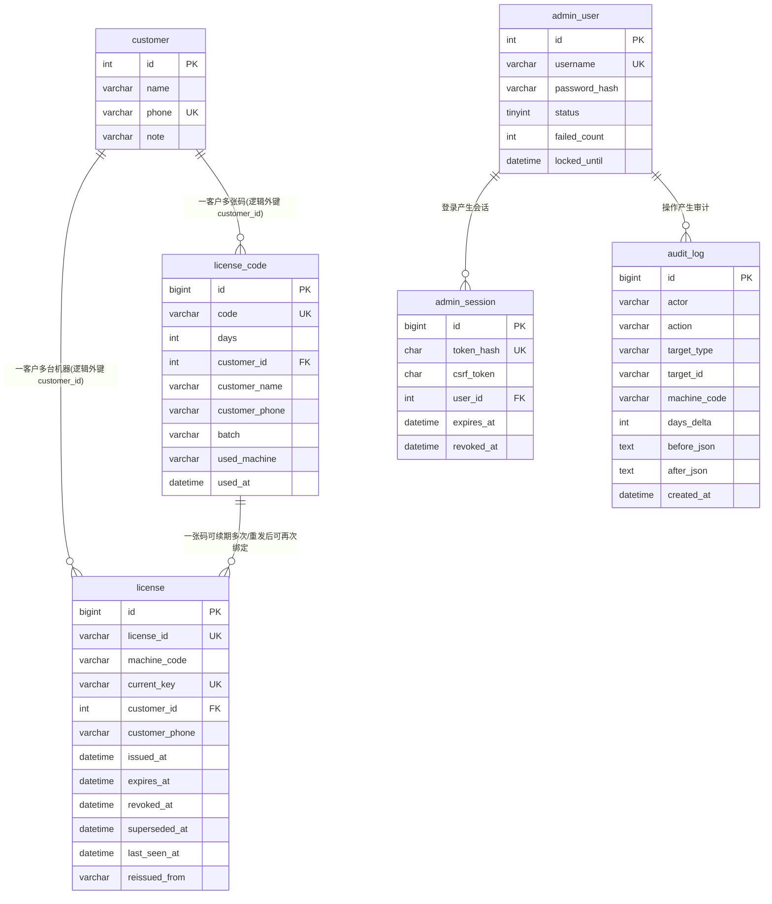
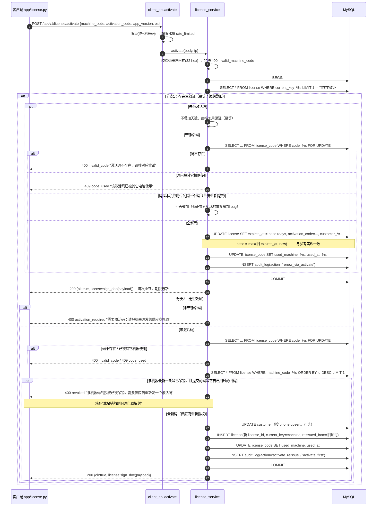
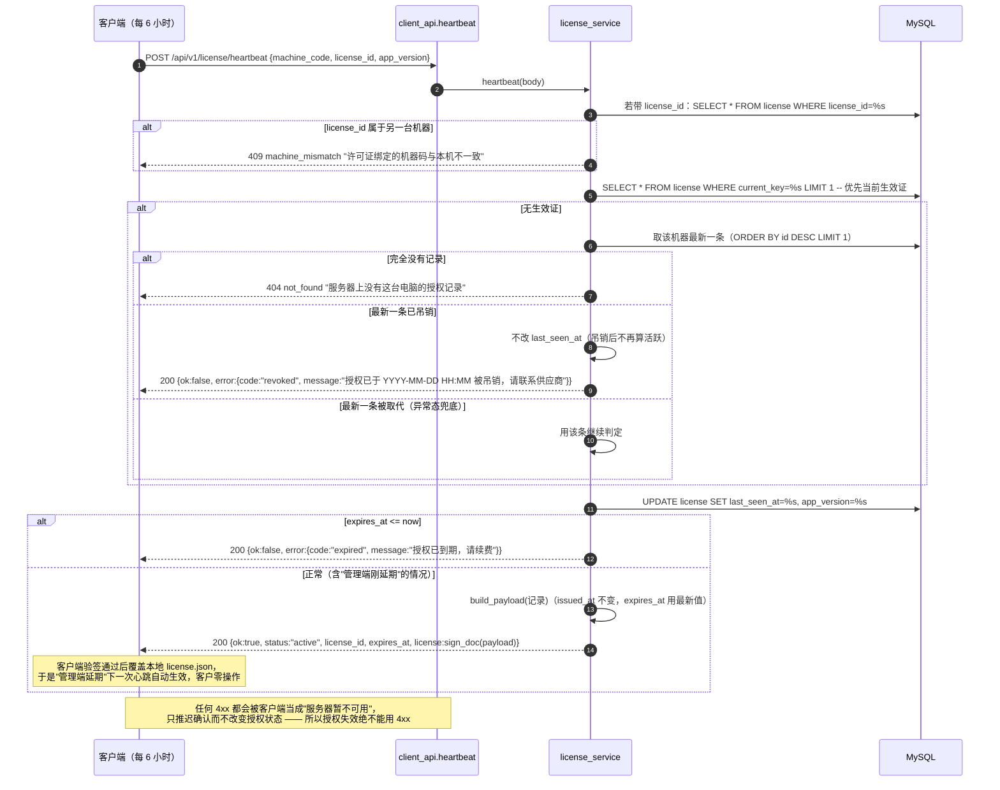
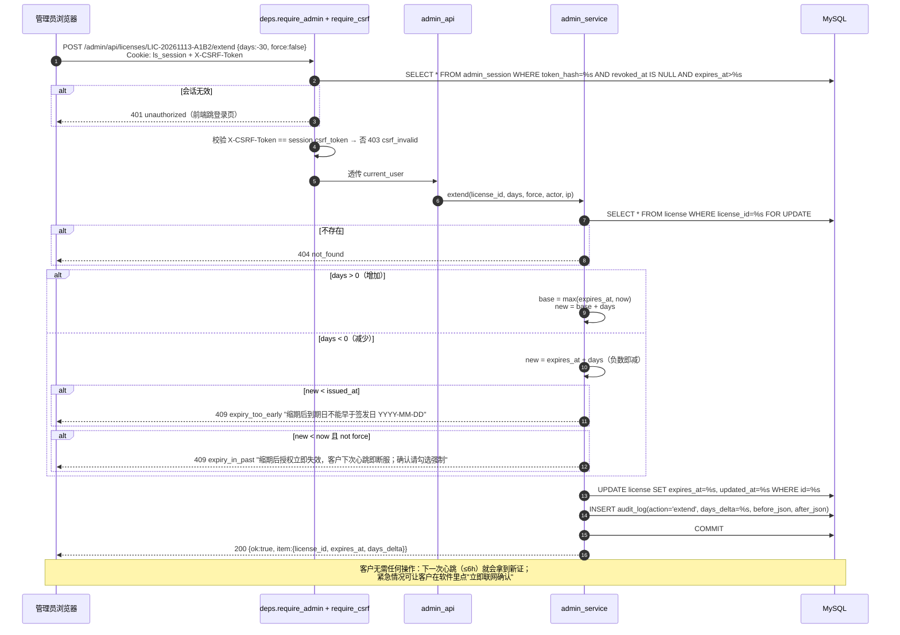
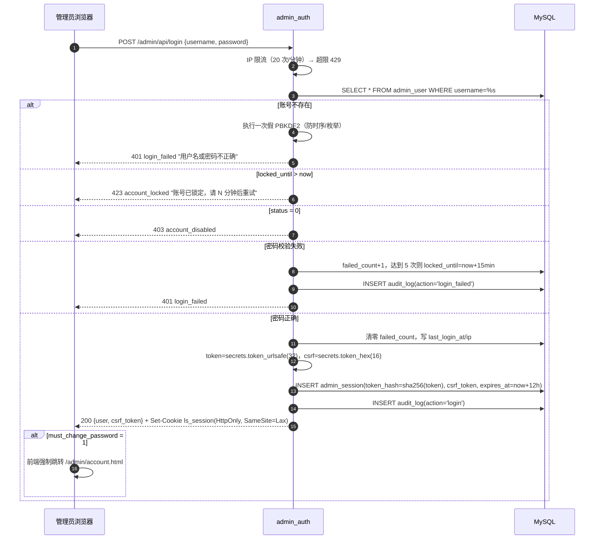
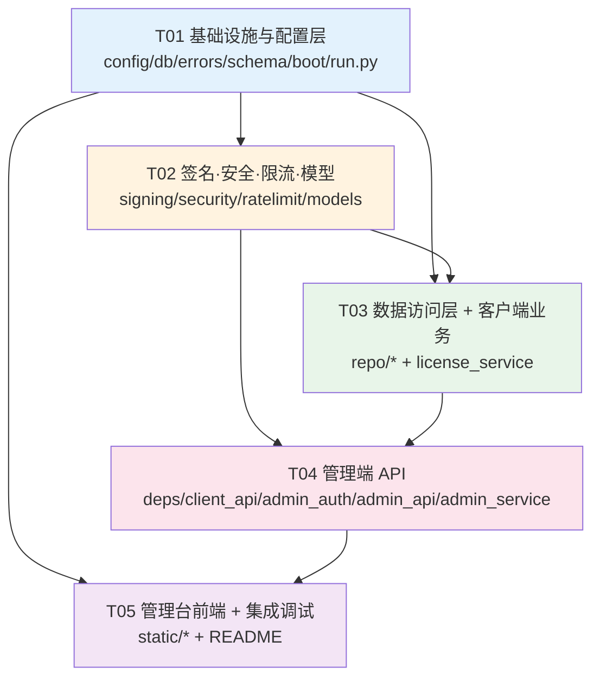

# 授权服务后台（license-server）系统设计

> 版本：v1.0（对应客户端 `APP_VERSION = 1.0.0`，契约 `kefu-system/docs/授权服务接口文档.md` v1）
> 目标：用 **MySQL 5.6 + FastAPI + 原生 HTML/JS** 实现正式授权服务后台，替换联调用的
> `kefu-system/tools/mock_license_server.py`，并补齐鉴权、审计、统计、客户管理。
> 本文档是给工程师一次性编码用的**实现契约**：字段名、路由、错误码、SQL、签名序列化、
> 限流参数、配置项全部以本文为准。

---

## 0. 一句话结论（实现前必读的 6 条硬约束）

1. **签名序列化必须逐字节一致**：`json.dumps(payload, ensure_ascii=False, sort_keys=True,
   separators=(",", ":"))`，否则客户端验签必失败。
2. **签发时间必须带时区**：payload 里 `issued_at` / `expires_at` 一律输出
   `2026-11-13T21:02:53+08:00` 形式（东八区）。
3. **心跳的"授权失效"必须用 `HTTP 200 + ok=false`**，禁止用 4xx。
4. **MySQL 5.6**：无 JSON 类型（用 TEXT 存 JSON 字符串）、无窗口函数/CTE、
   utf8mb4 索引 767 字节上限、不用 `NOW()` 参与业务计算（时间一律由 Python 传入 `%s`）。
5. **不引入新依赖**：密码哈希用 stdlib `hashlib.pbkdf2_hmac`，会话令牌用 stdlib `secrets`
   + 数据库存储，管理页用静态 HTML（FastAPI `StaticFiles` 托管），不用 Jinja2 / SQLAlchemy /
   passlib / python-jose / python-dotenv。
6. **所有 SQL 参数化**（pymysql `%s`），禁止任何字符串拼接用户输入。

---

## 1. 技术选型与实现难点

### 1.1 选型

| 层 | 选型 | 理由 |
|---|---|---|
| Web 框架 | **FastAPI**（已装）+ uvicorn | 参考实现同栈，契约里错误体、Pydantic 模型可直接复用；工程师零学习成本 |
| 数据访问 | **PyMySQL 1.2.4 裸 SQL + 自写极简连接池** | SQLAlchemy 未装且装不了；本项目 SQL 不多（~25 条），裸 SQL 反而能精确控制 5.6 兼容写法与索引使用 |
| 数据校验 | **Pydantic v2**（已装） | 请求体校验 + 自动 422 |
| 签名 | **cryptography（Ed25519）** | 与客户端一致；私钥只在服务端 |
| 密码哈希 | **stdlib `hashlib.pbkdf2_hmac`** | 不装 passlib/bcrypt；PBKDF2-HMAC-SHA256 260000 轮是 OWASP 推荐档位，stdlib 即够 |
| 会话 | **stdlib `secrets` 生成随机令牌 + DB 存 sha256** | 不装 python-jose（JWT 也需要服务端吊销，DB 会话更简单且可即时踢人） |
| 前端 | **原生 HTML + ES6 fetch + 一份公共 app.js** | 用户明确要求"服务端托管静态页，不要 Node 构建链" |
| 配置 | **env + 自写 `.env` 解析（20 行）** | 不装 python-dotenv |

### 1.2 难点与对策

| 难点 | 对策 |
|---|---|
| MySQL 5.6 没有"部分唯一索引"（一台机器只能一条生效证） | 用 **NULL 不参与唯一约束**的特性：`current_key VARCHAR(40) NULL`，生效时写机器码、吊销/被取代时置 NULL；`UNIQUE KEY uk_current_machine(current_key)` 即等价于"每台机器最多一条生效证"，违反时数据库直接报 1062，属于**主动防御** |
| 5.6 没有窗口函数，无法 `ROW_NUMBER()` 取"每台机器最新一条" | 用自增主键 `id` 排序：`ORDER BY id DESC LIMIT 1`；索引 `idx_machine_id(machine_code, id)` 直接覆盖该查询 |
| 5.6 无法生成日期序列，近 30 天趋势会缺天 | Python 侧生成连续 30 天日期列表 → SQL 只 `GROUP BY DATE(created_at)` → Python 补 0 |
| 参考实现"同码重复激活会重复叠加天数"（幂等 bug） | 正式后台修正：`当前证.activation_code == 请求码` 时**不再叠加**，直接返回原证（客户端无感） |
| 签名序列化跨进程一致 | `signing.py` 里 `payload_bytes` 只此一处实现，任何其它地方禁止自己 `json.dumps` payload |
| 会话与 CSRF | HttpOnly Cookie + DB 会话 + **双提交 CSRF 令牌**（详见 §4） |
| 5.6 DATETIME 无时区 | **DB 内全部存东八区本地时间（naive）**，出库时统一 `replace(tzinfo=TZ).isoformat()`；入库前统一 `astimezone(TZ).replace(tzinfo=None)`。统计按 `DATE()` 分组才不会跨时区错位 |

### 1.3 关键不变量（编码时反复对照）

- **INV-1** 一台机器任意时刻最多一条 `current_key` 非空的许可证。
- **INV-2** 许可证只新增不删除；吊销只写 `revoked_at`，绝不 `DELETE`。
- **INV-3** 激活码只新增不删除；`used_machine` 一旦非空永不改回空（除管理员重置，本版不提供）。
- **INV-4** payload 的 `issued_at` 取自记录首次签发时间，心跳重签**不改** `issued_at`
  （避免客户端"时钟回拨"误判）。
- **INV-5** 所有管理端写操作必须写 `audit_log`（含 before/after）。
- **INV-6** 任何 SQL 的时间比较参数都由 Python 传入，不写 `NOW()`（数据库时区不可控）。

---

## 2. 目录结构与文件职责

项目根：`D:\Git\wechatauto-replica\license-server\`（全新目录，独立于 kefu-system）

```
license-server/
├── requirements.txt              # 依赖清单（仅 fastapi/uvicorn/pydantic/cryptography/PyMySQL）
├── .env.example                  # 环境变量模板（不含真实密码；生产必须复制为 .env 或直接注入 env）
├── .gitignore                    # 忽略 .env / *.pem / __pycache__ / data/
├── README.md                     # 启动、初始化、反代 HTTPS、故障排查
├── run.py                        # 唯一启动入口：serve / init-db / create-admin / issue-code / check
├── docs/
│   └── design.md                 # 本文件
└── app/
    ├── __init__.py               # 空（声明包）
    ├── config.py                 # 读 env + .env，产出 Config 单例；含所有默认值与生产覆盖说明
    ├── errors.py                 # ApiError 异常类 + err() 工厂 + FastAPI 异常处理器（顶层 {"error":{}}）
    ├── db.py                     # 极简连接池 + get_conn/tx/query_one/query_all/execute/execute_many
    ├── schema.sql                # 全部建表 DDL（幂等，CREATE TABLE IF NOT EXISTS），启动时逐条执行
    ├── security.py               # PBKDF2 哈希/校验、会话令牌生成与校验、CSRF、Cookie 读写、客户端 IP
    ├── signing.py                # payload_bytes / load_private_key / build_payload / sign_doc / 时间工具
    ├── models.py                 # Pydantic 请求/响应模型（客户端 3 个 + 管理端全部）
    ├── ratelimit.py              # 内存滑动窗口限流器（按 key），/activate 与 /login 用
    ├── boot.py                   # 启动钩子：建表 → 初始化默认管理员 → 清理过期会话 → 自检打印
    ├── main.py                   # create_app()：注册路由/异常处理器/静态目录，导出 app
    ├── repo/
    │   ├── __init__.py
    │   ├── customers.py          # 客户档案：upsert_by_phone / search / get / list_with_stats
    │   ├── codes.py              # 激活码：batch_create / find_by_code(FOR UPDATE) / mark_used / list / count_stats
    │   ├── licenses.py           # 许可证：find_current / find_latest / find_by_license_id / insert / update_expiry / revoke / restore / list
    │   ├── admins.py             # 管理员与会话：get_by_username / update_login / create / 会话 CRUD
    │   ├── audit.py              # 审计：write(action, target, before, after, days_delta) / list
    │   └── stats.py              # 统计查询（全部 5.6 兼容写法），返回 dict
    ├── services/
    │   ├── __init__.py
    │   ├── license_service.py    # 客户端三接口的业务编排（激活四分支 / 心跳四分支）
    │   └── admin_service.py      # 管理端业务规则：延期/缩期/设到期日/吊销/恢复 + 审计 + 客户联动
    ├── api/
    │   ├── __init__.py
    │   ├── deps.py               # require_admin 依赖（Cookie 或 Bearer）、require_csrf、get_client_ip
    │   ├── client_api.py         # /api/v1/license/{activate,heartbeat,query} + /api/health
    │   ├── admin_auth.py         # /admin/api/{login,logout,me,password}
    │   └── admin_api.py          # /admin/api/{dashboard,codes,licenses,customers,audit}
    └── static/                   # 管理台（原生 HTML/JS，FastAPI StaticFiles 挂到 /admin）
        ├── login.html            # 登录页
        ├── index.html            # 仪表盘（统计卡片 + 近 30 天趋势 + 按手机号/客户聚合）
        ├── codes.html            # 激活码管理（批量生成/复制/筛选/导出）
        ├── licenses.html         # 许可证管理（列表/搜索/延期/缩期/设到期日/吊销/恢复）
        ├── customers.html        # 客户档案（列表/搜索/新增/该客户机器清单）
        ├── audit.html            # 审计日志
        ├── account.html          # 修改密码（首次登录强制跳转这里）
        ├── app.js                # 公共：fetch 封装（自动带 CSRF）、鉴权跳转、表格/分页/提示、时间格式化
        └── style.css             # 单文件样式（无框架）
```

**文件数**：31 个（含 3 个空 `__init__.py`）。工程师按 §9 的 5 个任务顺序实现。

---

## 3. 数据模型

### 3.1 设计决策：客户信息"混合冗余"（关键设计点）

**问题**：许可证与激活码都要带"客户名称 + 手机号"，且要按手机号聚合统计；同一手机号可对应多台机器。

**结论**：**`customer` 档案表（主数据） + `license` / `license_code` 上的快照冗余列**，物理外键不建。

| 方案 | 优点 | 缺点 | 结论 |
|---|---|---|---|
| A. 只在 license/code 上冗余 customer_name/phone | 写入最简单，统计零 JOIN | 客户改名/改号要全表 UPDATE；同一客户写法不一致（"某某汽配"/"某某汽配厂"）导致聚合失真；没有"客户"这个可管理实体 | ✗ 单独使用 |
| B. 只建 customer 表 + 外键，license 只存 customer_id | 无冗余，改名自动生效 | **5.6 每次统计/列表都要 JOIN**（列表分页 + 手机号模糊搜索都无法走索引）；历史审计语义丢失（三年前那张证的客户名应保持当时的样子）；MySQL 5.6 无窗口函数，聚合 SQL 会明显复杂 | ✗ 单独使用 |
| **C. 混合（采用）** | ① 聚合/搜索在单表上完成，`idx_phone` 直接命中；② 档案表提供唯一客户实体（以手机号为业务主键，天然去重）；③ 快照保留历史语义，改档不影响已签发证 | 需要"写档案 + 写快照"两步（在同一个事务内，风险可控） | ✓ |

**具体规则**

- `customer.phone` 唯一（业务主键），`name` 普通前缀索引。手机号为空的客户**不建档**，
  只在 code/license 上留 `customer_name` 快照（`customer_id = 0`）。
- 生成激活码 / 激活时：若 `phone` 非空 → `upsert_by_phone(phone, name)` 拿 `customer_id`，
  并把当时的 `name/phone` 写进 code/license 快照列。
- 物理外键**不建**：① 5.6 外键在批量导入/删除客户时会加额外锁；② 业务上要求"客户档案可停用
  但历史许可证必须保留"，外键会挡住清理；③ 逻辑外键 + `customer_id=0` 表示无档案，足够。
- 冗余列长度：`customer_name VARCHAR(64)`、`customer_phone VARCHAR(32)`（手机号 11 位，
  留 +86/分机号余量）。**phone 建普通索引**（不是唯一），因为 code/license 允许同号多行。

### 3.2 表清单

| 表 | 作用 | 预估行数 |
|---|---|---|
| `admin_user` | 管理员账号（PBKDF2 哈希、锁定状态） | < 20 |
| `admin_session` | 管理端会话（sha256 令牌、CSRF、过期） | < 100 |
| `customer` | 客户档案（手机号唯一） | < 5000 |
| `license_code` | 激活码（批次、天数、客户快照、绑定机器） | < 10 万 |
| `license` | 许可证（历史全留，`current_key` 保证一机一证生效） | < 10 万 |
| `audit_log` | 审计日志（谁、何时、改了什么、旧值→新值） | < 50 万 |

### 3.3 建表 SQL（MySQL 5.6 兼容，完整可执行）

> 全部 `ENGINE=InnoDB DEFAULT CHARSET=utf8mb4 COLLATE=utf8mb4_unicode_ci`；
> 所有时间列由 Python 写入东八区本地时间，**不使用** `DEFAULT CURRENT_TIMESTAMP`（避免与时区/默认值语义纠缠）；
> `TEXT` 列不设默认值（5.6 不允许）。

```sql
-- ---------------------------------------------------------------------------
-- 1. 管理员账号
-- ---------------------------------------------------------------------------
CREATE TABLE IF NOT EXISTS admin_user (
  id                  INT UNSIGNED NOT NULL AUTO_INCREMENT,
  username            VARCHAR(32)  NOT NULL                COMMENT '登录名（小写，唯一）',
  password_hash       VARCHAR(255) NOT NULL                COMMENT 'pbkdf2_sha256$迭代次数$base64(salt)$base64(dk)',
  display_name        VARCHAR(64)  NOT NULL DEFAULT ''      COMMENT '显示名',
  role                VARCHAR(16)  NOT NULL DEFAULT 'admin' COMMENT 'admin=全部权限（本版仅一种）',
  status              TINYINT      NOT NULL DEFAULT 1       COMMENT '1=启用 0=停用',
  must_change_password TINYINT     NOT NULL DEFAULT 0       COMMENT '1=首登/重置后必须改密',
  failed_count        INT          NOT NULL DEFAULT 0       COMMENT '连续登录失败次数',
  locked_until        DATETIME     NULL     DEFAULT NULL    COMMENT '锁定到期时间（NULL=未锁）',
  last_login_at       DATETIME     NULL     DEFAULT NULL,
  last_login_ip       VARCHAR(45)  NOT NULL DEFAULT ''      COMMENT '兼容 IPv6',
  password_updated_at DATETIME     NULL     DEFAULT NULL,
  created_at          DATETIME     NOT NULL,
  updated_at          DATETIME     NOT NULL,
  PRIMARY KEY (id),
  UNIQUE KEY uk_username (username)
) ENGINE=InnoDB DEFAULT CHARSET=utf8mb4 COLLATE=utf8mb4_unicode_ci COMMENT='管理端账号';
-- uk_username：登录查询 + 禁止重名。VARCHAR(32) utf8mb4 = 128 字节，远低于 767，无需前缀。

-- ---------------------------------------------------------------------------
-- 2. 管理端会话（令牌只存 sha256，库泄露也无法冒充）
-- ---------------------------------------------------------------------------
CREATE TABLE IF NOT EXISTS admin_session (
  id             BIGINT UNSIGNED NOT NULL AUTO_INCREMENT,
  token_hash     CHAR(64)    NOT NULL              COMMENT 'sha256(token) 十六进制，仅存哈希',
  csrf_token     CHAR(32)    NOT NULL              COMMENT 'CSRF 双提交令牌（随机 32 hex）',
  user_id        INT UNSIGNED NOT NULL,
  username       VARCHAR(32) NOT NULL DEFAULT ''   COMMENT '冗余，便于日志免查',
  ip             VARCHAR(45) NOT NULL DEFAULT '',
  user_agent     VARCHAR(255) NOT NULL DEFAULT '',
  created_at     DATETIME    NOT NULL,
  last_active_at DATETIME    NOT NULL,
  expires_at     DATETIME    NOT NULL,
  revoked_at     DATETIME    NULL DEFAULT NULL     COMMENT '登出/改密踢人时写入',
  PRIMARY KEY (id),
  UNIQUE KEY uk_token (token_hash),
  KEY idx_user (user_id),
  KEY idx_expires (expires_at)
) ENGINE=InnoDB DEFAULT CHARSET=utf8mb4 COLLATE=utf8mb4_unicode_ci COMMENT='管理端会话';
-- uk_token：每次请求按令牌哈希精确查一条（唯一索引保证不匹配多行）。
-- idx_user：改密/停用时按用户批量吊销。
-- idx_expires：启动与登录时清理过期会话。

-- ---------------------------------------------------------------------------
-- 3. 客户档案（手机号作为业务主键，一客户多台机器）
-- ---------------------------------------------------------------------------
CREATE TABLE IF NOT EXISTS customer (
  id         INT UNSIGNED NOT NULL AUTO_INCREMENT,
  name       VARCHAR(64)  NOT NULL DEFAULT ''   COMMENT '客户名称',
  phone      VARCHAR(32)  NOT NULL              COMMENT '手机号（唯一业务键，不允许空串入档）',
  note       VARCHAR(255) NOT NULL DEFAULT '',
  created_at DATETIME     NOT NULL,
  updated_at DATETIME     NOT NULL,
  PRIMARY KEY (id),
  UNIQUE KEY uk_phone (phone),
  KEY idx_name (name(32))
) ENGINE=InnoDB DEFAULT CHARSET=utf8mb4 COLLATE=utf8mb4_unicode_ci COMMENT='客户档案';
-- uk_phone：手机号唯一，保证"同一手机号一个客户实体"，是聚合统计的口径基础。
-- idx_name (name(32))：前缀索引 128 字节（5.6 utf8mb4 767 上限内），支持按客户名左模糊搜索。

-- ---------------------------------------------------------------------------
-- 4. 激活码
-- ---------------------------------------------------------------------------
CREATE TABLE IF NOT EXISTS license_code (
  id             BIGINT UNSIGNED NOT NULL AUTO_INCREMENT,
  code           VARCHAR(32)  NOT NULL              COMMENT 'KF-XXXX-XXXX-XXXX-XXXX',
  days           INT          NOT NULL              COMMENT '兑换后的有效天数',
  edition        VARCHAR(32)  NOT NULL DEFAULT 'standard',
  customer_id    INT UNSIGNED NOT NULL DEFAULT 0    COMMENT '客户档案 id，0=无档案（逻辑外键，不建 FK）',
  customer_name  VARCHAR(64)  NOT NULL DEFAULT ''   COMMENT '生成时快照',
  customer_phone VARCHAR(32)  NOT NULL DEFAULT ''   COMMENT '生成时快照',
  batch          VARCHAR(32)  NOT NULL DEFAULT ''   COMMENT '批次号 B20261114-ABCD，便于按批筛选/复制',
  note           VARCHAR(255) NOT NULL DEFAULT '',
  used_machine   VARCHAR(40)  NOT NULL DEFAULT ''   COMMENT '已绑定机器码，空=未使用',
  used_at        DATETIME     NULL DEFAULT NULL,
  created_by     VARCHAR(32)  NOT NULL DEFAULT ''   COMMENT '生成人 username',
  created_at     DATETIME     NOT NULL,
  PRIMARY KEY (id),
  UNIQUE KEY uk_code (code),
  KEY idx_used_machine (used_machine),
  KEY idx_phone (customer_phone),
  KEY idx_batch (batch),
  KEY idx_created (created_at)
) ENGINE=InnoDB DEFAULT CHARSET=utf8mb4 COLLATE=utf8mb4_unicode_ci COMMENT='激活码';
-- uk_code：激活时按码精确取一条 + 防重复生成。
-- idx_used_machine：按机器反查用过的码（客服排查"这台机用了哪个码"）；也用于"未使用=空串"计数。
-- idx_phone：按手机号定位该客户买过的码。
-- idx_batch：按批次导出/筛选。
-- idx_created：近 30 天新增趋势 GROUP BY DATE(created_at) 的范围扫描入口。

-- ---------------------------------------------------------------------------
-- 5. 许可证（历史全留；current_key 保证一机一证生效）
-- ---------------------------------------------------------------------------
CREATE TABLE IF NOT EXISTS license (
  id             BIGINT UNSIGNED NOT NULL AUTO_INCREMENT,
  license_id     VARCHAR(32)  NOT NULL              COMMENT 'LIC-yyyymmdd-XXXX，业务唯一号',
  machine_code   VARCHAR(40)  NOT NULL              COMMENT '32 位十六进制 + 7 个横杠 = 39',
  customer_id    INT UNSIGNED NOT NULL DEFAULT 0,
  customer_name  VARCHAR(64)  NOT NULL DEFAULT '',
  customer_phone VARCHAR(32)  NOT NULL DEFAULT '',
  edition        VARCHAR(32)  NOT NULL DEFAULT 'standard',
  activation_code VARCHAR(32) NOT NULL DEFAULT ''   COMMENT '本次签发/续期使用的激活码',
  issued_at      DATETIME     NOT NULL              COMMENT '首次签发时间（心跳不修改）',
  expires_at     DATETIME     NOT NULL              COMMENT '到期时间（续期/缩期只改这一列）',
  grace_days     SMALLINT     NOT NULL DEFAULT 7,
  features       VARCHAR(255) NOT NULL DEFAULT 'monitor,reply,ai' COMMENT '逗号分隔（5.6 无 JSON）',
  revoked_at     DATETIME     NULL DEFAULT NULL     COMMENT '非 NULL = 已吊销',
  superseded_at  DATETIME     NULL DEFAULT NULL     COMMENT '非 NULL = 已被更新的证取代（防御性）',
  reissued_from  VARCHAR(32)  NOT NULL DEFAULT ''   COMMENT '吊销后重发时指向旧 license_id',
  last_seen_at   DATETIME     NULL DEFAULT NULL     COMMENT '最近一次心跳（活跃统计口径）',
  app_version    VARCHAR(32)  NOT NULL DEFAULT '',
  os             VARCHAR(64)  NOT NULL DEFAULT '',
  note           VARCHAR(255) NOT NULL DEFAULT '',
  current_key    VARCHAR(40)  NULL DEFAULT NULL     COMMENT '生效时=机器码，吊销/被取代=NULL（NULL 不参与唯一约束）',
  created_at     DATETIME     NOT NULL,
  updated_at     DATETIME     NOT NULL,
  PRIMARY KEY (id),
  UNIQUE KEY uk_license_id (license_id),
  UNIQUE KEY uk_current_machine (current_key),
  KEY idx_machine_id (machine_code, id),
  KEY idx_phone (customer_phone),
  KEY idx_customer (customer_id),
  KEY idx_expires (expires_at),
  KEY idx_last_seen (last_seen_at),
  KEY idx_created (created_at),
  KEY idx_revoked (revoked_at)
) ENGINE=InnoDB DEFAULT CHARSET=utf8mb4 COLLATE=utf8mb4_unicode_ci COMMENT='许可证（一台机器一条生效记录）';
-- uk_license_id：业务号唯一，心跳按号查。
-- uk_current_machine：**核心约束**。current_key 生效时为机器码、失效时为 NULL；
--   MySQL 唯一索引允许多个 NULL，于是等价于"部分唯一索引"，从数据库层面堵死
--   "同一台机器两条生效授权"（参考实现靠代码自觉，踩过坑）。
-- idx_machine_id：ORDER BY id DESC LIMIT 1 取该机器最新一条（覆盖索引，无 filesort）。
-- idx_phone：按手机号聚合/搜索该客户所有机器。
-- idx_customer：按客户档案 id 关联清单。
-- idx_expires：到期统计与"即将到期"筛选。
-- idx_last_seen：近 7 天活跃心跳统计。
-- idx_created：按天新增趋势。
-- idx_revoked：吊销数统计。

-- ---------------------------------------------------------------------------
-- 6. 审计日志（每次管理端写操作一条，不删不改）
-- ---------------------------------------------------------------------------
CREATE TABLE IF NOT EXISTS audit_log (
  id          BIGINT UNSIGNED NOT NULL AUTO_INCREMENT,
  actor_id    INT UNSIGNED NOT NULL DEFAULT 0    COMMENT '操作人 id（0=系统/匿名）',
  actor       VARCHAR(32)  NOT NULL DEFAULT ''    COMMENT '操作人 username',
  action      VARCHAR(32)  NOT NULL               COMMENT 'login/logout/change_password/create_codes/extend/set_expiry/revoke/restore/create_customer...',
  target_type VARCHAR(16)  NOT NULL DEFAULT ''    COMMENT 'license/code/customer/admin',
  target_id   VARCHAR(64)  NOT NULL DEFAULT ''    COMMENT 'license_id / code / customer id',
  machine_code VARCHAR(40) NOT NULL DEFAULT ''    COMMENT '关联机器码（便于按机器查历史）',
  days_delta  INT          NOT NULL DEFAULT 0     COMMENT '本次增减天数（缩期为负）',
  before_json TEXT         NULL                   COMMENT '变更前（JSON 字符串；5.6 无 JSON 类型）',
  after_json  TEXT         NULL                   COMMENT '变更后',
  ip          VARCHAR(45)  NOT NULL DEFAULT '',
  note        VARCHAR(255) NOT NULL DEFAULT ''    COMMENT '操作备注/吊销原因',
  created_at  DATETIME     NOT NULL,
  PRIMARY KEY (id),
  KEY idx_target (target_type, target_id),
  KEY idx_machine (machine_code),
  KEY idx_created (created_at),
  KEY idx_action (action)
) ENGINE=InnoDB DEFAULT CHARSET=utf8mb4 COLLATE=utf8mb4_unicode_ci COMMENT='管理端审计日志';
-- idx_target：查某张证/某个码的全部操作历史。
-- idx_machine：售后按机器码查"什么时候被吊销/延期过"（核心售后场景）。
-- idx_created：审计页按时间倒序分页。
-- idx_action：按动作筛选（如所有 revoke）。
```

### 3.4 实体关系图



### 3.5 DDL 已实测验证（2026-11-14，测试库 192.168.1.172 `wechat_kefu`）

上面 6 张表**已在真实 MySQL 5.6.38-log 上逐条执行通过**，并验证了三件关键事实：

| 验证项 | 结果 |
|---|---|
| 6 张表建表语句 | 全部成功（无 JSON 类型、无窗口函数、utf8mb4 索引均未超 767 字节） |
| 同机器插入第二条 `current_key` 相同的证 | 报 **1062 Duplicate entry**，`uk_current_machine` 生效（INV-1 由数据库兜底） |
| 同机器多条 `current_key IS NULL`（历史/吊销记录） | 可正常共存 |
| `SUM(CASE WHEN ... %s)` 统计 SQL | 可执行，返回值是 **`Decimal`** → 代码里必须 `int(x or 0)` 归一 |
| `GROUP BY DATE(created_at)` | 可执行（近 30 天趋势依赖它 + Python 补 0） |

> 验证用的临时脚本已删除、表已 DROP 掉，测试库恢复为空，工程师可以直接用
> `python run.py init-db` 重新验证一遍。**DDL 不需要工程师重新设计，照抄即可。**

### 3.6 `current_key` 维护规则表（每条写路径都必须遵守）

| 操作 | 对 `current_key` 的处理 |
|---|---|
| 新建许可证（首次激活 / 吊销后重发） | 设为 `machine_code`（若该机器已有生效记录 → 数据库 1062，属于 bug 暴露，转 500 并记日志） |
| 续期 / 缩期 / 直接设到期日 | **不变**（保持 `machine_code`；已过期的证仍保留 current_key，才能靠心跳续上） |
| 吊销 | 置 `NULL` |
| 恢复 | 置 `machine_code`；若冲突（同机已有生效证）→ 409 `already_active` |
| 被新证取代（防御性，本版不主动产生） | 置 `NULL` + `superseded_at = now` |

---

## 4. 鉴权方案

### 4.1 密码存储

```
格式： pbkdf2_sha256$260000$<base64(salt 16B)>$<base64(dk 32B)>
算法： hashlib.pbkdf2_hmac("sha256", password.encode("utf-8"), salt, 260000, dklen=32)
比较： hmac.compare_digest（防时序侧信道）
```
- 迭代次数写入哈希串本身 → 将来提高迭代数可在线平滑升级（验证成功后若迭代数低于当前配置则重算并更新）。
- 密码策略（应用层）：长度 8–64，不得包含空格；`must_change_password=1` 时除 `me`/`password`/`logout` 外一律 403 `must_change_password`。

### 4.2 会话令牌

- 登录成功：`token = secrets.token_urlsafe(32)`（43 字符），响应 `Set-Cookie`；
  DB 只存 `sha256(token).hexdigest()`（`CHAR(64)`）。
- 有效期：`SESSION_TTL_HOURS`（默认 **12 小时**）绝对过期；每次请求若剩余寿命 < 一半
  则顺延到 now+TTL，但**总寿命不超过 `created_at + 7 天`**（防无限续命）。
- 认证方式（两者都支持，优先级 Cookie 先）：
  1. `Cookie: ls_session=<token>`（主要，管理台用）；
  2. `Authorization: Bearer <token>`（运维脚本/curl 用，此时**不校验 CSRF**）。
- Cookie 属性：`HttpOnly; SameSite=Lax; Path=/; Max-Age=TTL`；`Secure` 由
  `COOKIE_SECURE=1` 控制（生产必须 1；本地 http 联调设 0）。
- 登出：`revoked_at = now` + 清 Cookie。
- 改密成功：吊销该用户**除当前会话外**的全部会话（其他地方登录的立刻失效）。

### 4.3 CSRF

Cookie 认证 + 有状态的写接口必须防 CSRF。采用**双提交令牌**（无状态、无新依赖）：

1. 登录成功时生成 `csrf_token = secrets.token_hex(16)`（32 hex），写入 `admin_session.csrf_token`
   并且**同时**作为响应体字段返回（不放非 HttpOnly Cookie，减少攻击面）。
2. 管理台把它存 `sessionStorage`，每个写请求带 `X-CSRF-Token: <csrf>`。
3. 服务端校验：`hmac.compare_digest(session.csrf_token, header)`，不等 → 403 `csrf_invalid`。
4. `SameSite=Lax` 已经阻断绝大多数跨站 POST；双提交是第二层。
5 GET 请求不校验 CSRF（但**不改数据**，这是硬规则）。

### 4.4 登录失败锁定

- 同 username 连续失败 `LOGIN_MAX_FAILED`（默认 5）次 → `locked_until = now + LOGIN_LOCK_MINUTES`（默认 15）。
- 锁定期内即使密码正确也返回 423 `account_locked`（提示剩余分钟）。
- 成功登录清零 `failed_count`、清 `locked_until`。
- 用户名不存在时也走一次假哈希校验（防用户名枚举与时序差异），错误信息统一为
  "用户名或密码不正确"。
- 另有 IP 级限流 `LOGIN_RATE_LIMIT`（默认 20 次/分钟）兜底撞库。

### 4.5 客户端接口的防爆破

| 接口 | 限流键 | 阈值 |
|---|---|---|
| `POST /api/v1/license/activate` | `(客户端IP, machine_code)` | `ACTIVATE_RATE_LIMIT`，默认 **10 次/60 秒** |
| `POST /api/v1/license/heartbeat` | 不限流（客户端 6 小时一次，正常流量极小；异常由日志观察） |
| `GET /api/v1/license/query` | 客户端 IP | 30 次/60 秒 |
| `POST /admin/api/login` | 客户端 IP | `LOGIN_RATE_LIMIT`，默认 20 次/60 秒 |

> 限流器为**进程内**滑动窗口（`ratelimit.py`，dict[tuple]->deque + 一把锁，超阈值 429）。
> 多 worker 部署时每个进程独立计数 → **生产建议 uvicorn `--workers 1`**（本服务 QPS 极低），
> 若将来多 worker，需换成 DB/Redis 计数（在 §11 待明确事项登记）。

### 4.6 客户端 IP 获取

```
TRUST_PROXY=1（默认）时：X-Forwarded-For 取第一个非空项 → X-Real-IP → socket 对端
TRUST_PROXY=0 时：只用 socket 对端（防伪造头）
```
`VARCHAR(45)` 兼容 IPv6。

---

## 5. API 清单

约定：
- 错误体统一 **顶层** `{"error": {"code": "...", "message": "中文可操作提示"}}`
  （由 `errors.py` 的异常处理器保证，FastAPI 默认 `{"detail": ...}` 被摊平；
  客户端 `extract_error` 两种都兼容，但我们只输出顶层这种）。
- 成功体统一 `{"ok": true, ...}`（与参考实现一致，管理台直接复用）。
- 时间输出 `2026-11-13T21:02:53+08:00`。

### 5.1 客户端接口（无需鉴权，路径写死在客户端）

| # | 方法 | 路径 | 鉴权 | 入参 | 出参 |
|---|---|---|---|---|---|
| C1 | POST | `/api/v1/license/activate` | 无（限流） | `machine_code`(必), `activation_code`, `app_version`, `os` | 200 `{ok:true, license:{key_id,payload,signature}}` |
| C2 | POST | `/api/v1/license/heartbeat` | 无 | `machine_code`(必), `license_id`, `app_version` | 200 `{ok:true, status, license_id, expires_at, license:{...}}` / 200 `{ok:false, error:{...}}` |
| C3 | GET | `/api/v1/license/query` | 无（限流） | `machine_code` | 200 `{ok:true, license:<payload>, revoked:bool}` |
| C4 | GET | `/api/health` | 无 | — | 200 `{ok:true, db:true, version, time}`；DB 不通 → 503 `{ok:false,...}` |

**C1 错误码**（与参考实现逐一对齐）

| code | HTTP | 触发条件 | message（中文，面向客户） |
|---|---|---|---|
| `invalid_machine_code` | 400 | 机器码非 32 位十六进制 | "机器码格式不正确（应为 32 位十六进制）" |
| `activation_required` | 400 | 无生效证且未带激活码 | "需要激活码：请把机器码发给供应商换取" |
| `invalid_code` | 400 | 激活码不存在 | "激活码不存在，请核对后重试" |
| `code_used` | 409 | 码已被**其它**机器使用 | "该激活码已被其它电脑使用" |
| `revoked` | 400 | 该机器已吊销，且提交的是它自己用过的旧码 | "该机器码的授权已被吊销，需要供应商重新发一个激活码" |
| `rate_limited` | 429 | 触发限流 | "请求过于频繁，请 1 分钟后再试" |
| `internal_error` | 500 | 未预期异常（事务已回滚） | "服务器内部错误，请稍后重试或联系供应商" |

**C2 业务失败码**（一律 **200 + ok=false**）

| code | 触发条件 | message |
|---|---|---|
| `revoked` | 记录已吊销 | "授权已于 2026-11-20 10:00 被吊销，请联系供应商" |
| `expired` | `expires_at <= now` | "授权已到期，请续费" |

**C2 请求错误码**（4xx，真·请求错误）

| code | HTTP | 条件 |
|---|---|---|
| `not_found` | 404 | 该机器码/许可证号没有任何记录 |
| `machine_mismatch` | 409 | 请求带了 `license_id`，但它属于另一台机器 |

> ⚠️ C2 的四步判定顺序（与参考实现一致，**不要改**）：
> `not_found(404)` → `machine_mismatch(409)` → `revoked(200/ok=false)` →
> 更新 `last_seen_at` → `expired(200/ok=false)` → `200/ok=true`。
> 注意 `revoked` 判定在 `expired` 之前：被吊销且已过期的机器应提示"已吊销"，不是"请续费"。

### 5.2 管理端鉴权接口

| # | 方法 | 路径 | 鉴权 | 入参 | 出参 / 说明 |
|---|---|---|---|---|---|
| A1 | POST | `/admin/api/login` | 无（IP 限流） | `username`, `password` | 200 `{ok:true, user:{id,username,display_name,role,must_change_password}, csrf_token}` + `Set-Cookie: ls_session` |
| A2 | POST | `/admin/api/logout` | 会话 + CSRF | — | 200 `{ok:true}` + 清 Cookie |
| A3 | GET | `/admin/api/me` | 会话 | — | 200 `{ok:true, user, csrf_token}`（刷新页面时取回 CSRF） |
| A4 | POST | `/admin/api/password` | 会话 + CSRF | `old_password`, `new_password` | 200 `{ok:true}`；非法旧密码 400 `old_password_wrong` |

**A1 错误码**：`login_failed` 401（统一文案"用户名或密码不正确"）、
`account_locked` 423（"账号已锁定，请 N 分钟后重试"）、`account_disabled` 403、
`rate_limited` 429、`invalid_param` 400。
**通用鉴权错误**：`unauthorized` 401（未登录/令牌过期，管理台收到后跳登录页）、
`csrf_invalid` 403、`forbidden` 403、`must_change_password` 403（先改密）。

### 5.3 管理端业务接口（前缀 `/admin/api`，全部"会话 + 写操作需 CSRF"）

| # | 方法 | 路径 | 入参 | 出参 / 说明 |
|---|---|---|---|---|
| B1 | GET | `/admin/api/dashboard` | `days`(默认30, 7–90) | 全部统计口径，见 §6 |
| B2 | POST | `/admin/api/codes` | `count`(1–500), `days`(1–3650), `customer`, `customer_phone`, `edition`, `note`, `batch` | 200 `{ok:true, items:[{code,...}], batch}`（兼容 mock 的入参名 `customer`） |
| B3 | GET | `/admin/api/codes` | `q`, `status`(`all/unused/used`), `phone`, `batch`, `page`, `size` | 200 `{ok:true, items, total, page, size}` |
| B4 | GET | `/admin/api/codes/export` | `batch` 或 `q` | `text/plain; charset=utf-8`，一行一个码（浏览器直接下载/复制） |
| B5 | GET | `/admin/api/licenses` | `q`(机器码/客户名/手机号/许可证号), `status`(`all/active/expired/revoked/superseded/current`), `phone`, `page`, `size` | 200 `{ok:true, items, total, page, size}`，每行带 `role` 标记 |
| B6 | POST | `/admin/api/licenses/{license_id}/renew` | `days`(1–3650) | **兼容 mock** 的延期接口；规则同 B7 的正数分支 |
| B7 | POST | `/admin/api/licenses/{license_id}/extend` | `days`(可负, -3650..3650), `force`(bool) | **统一增减天数**：`days>0` 增加、`days<0` 减少 |
| B8 | POST | `/admin/api/licenses/{license_id}/expiry` | `expires_at`(`YYYY-MM-DD` 或完整 ISO8601), `force`(bool) | 直接设定到期日 |
| B9 | POST | `/admin/api/licenses/{license_id}/revoke` | `reason`(可空), `force`(bool, 该机器已有更新证时需 true) | 吊销 |
| B10 | POST | `/admin/api/licenses/{license_id}/restore` | — | 恢复；同机已有生效证 → 409 `already_active` |
| B11 | GET | `/admin/api/licenses/{license_id}` | — | 单证详情 + 该机器全部历史 + 该机器用的码 |
| B12 | GET | `/admin/api/customers` | `q`, `page`, `size` | 客户列表（含机器数/生效数/最近到期/最近心跳） |
| B13 | POST | `/admin/api/customers` | `name`, `phone`(必), `note` | 新增/更新客户档案（按 phone upsert） |
| B14 | GET | `/admin/api/customers/{id}` | — | 客户详情 + 该客户所有机器与激活码 |
| B15 | GET | `/admin/api/machines` | `q`(手机号/客户名/机器码) | **按手机号或客户名定位机器码**（轻量：id/machine/name/phone/expires/status） |
| B16 | GET | `/admin/api/audit` | `action`, `machine_code`, `q`, `page`, `size` | 审计日志（倒序） |
| B18 | POST | `/admin/api/licenses/{license_id}/customer` | `customer`, `phone`（至少一个） | 补录/修改许可证客户绑定（无客户信息的码激活后补录）；手机号非空则 upsert 客户档案并回写 `customer_id`；审计 `bind_customer` |
| B19 | POST | `/admin/api/codes/{code}/void` | — | 作废**未使用**的激活码（销毁）；已使用的码 → 409 `code_used`（只能吊销许可证）；重复作废 → 409 `already_voided`；作废后激活返回 400 `code_voided`；审计 `void_code` |

> **B4 导出（CSV）**：`GET /admin/api/codes/export` 与列表共用筛选参数
> （`q`/`status`(all/unused/used/voided)/`phone`/`batch`），导出的即当前筛选结果；
> 列：激活码、天数、版本、批次、客户、手机号、状态、绑定机器码、使用时间、
> 生成时间、生成人、备注（UTF-8 带 BOM，Excel 可直接打开）。
| B17 | GET | `/admin/api/meta` | — | 字典：edition 选项、默认天数、默认宽限、限流参数（前端渲染用） |

**B7/B8 错误码**

| code | HTTP | 条件 |
|---|---|---|
| `not_found` | 404 | 许可证不存在 |
| `invalid_days` | 400 | `days == 0` 或超范围 |
| `expiry_too_early` | 409 | 新到期日 < `issued_at`（硬保护，`force` 也不能越过） |
| `expiry_in_past` | 409 | 新到期日 < 现在（会导致客户立刻断服）→ 需 `force=true` |
| `invalid_expires_at` | 400 | 日期格式不可解析 |

**B9/B10 错误码**：`not_found` 404、`already_revoked` 409（重复吊销）、
`not_revoked` 409（恢复一个没吊销的证）、`already_active` 409（B10：同机已有生效证，
消息里给出那条 `license_id`）、`superseded_require_force` 409（B9：该机器已有更新的证，
吊销旧证无意义，需 `force=true`）。

### 5.4 页面路由（静态托管）

| 路径 | 文件 | 说明 |
|---|---|---|
| `/` | 302 → `/admin/` | 根路径跳管理台 |
| `/admin/` | `static/index.html` | 仪表盘（未登录时 app.js 跳 login.html） |
| `/admin/login.html` | `static/login.html` | 登录 |
| `/admin/codes.html` | — | 激活码管理 |
| `/admin/licenses.html` | — | 许可证管理 |
| `/admin/customers.html` | — | 客户档案 |
| `/admin/audit.html` | — | 审计日志 |
| `/admin/account.html` | — | 修改密码 |
| `/admin/app.js`, `/admin/style.css` | — | 公共资源 |
| `/docs` | FastAPI 自带 Swagger | 运维调试（生产可用 `ENABLE_DOCS=0` 关闭） |

> 静态页**不含任何数据**，页面本身公开可下载不构成泄露；所有数据都来自鉴权后的
> `/admin/api/*`。业务路由必须在 `StaticFiles` 挂载**之前**注册（FastAPI 按注册顺序匹配）。

---

## 6. 统计口径（每个指标的精确定义）

> 统一约定：`now` 由 Python 传入（东八区 naive DATETIME），SQL 里**不出现 `NOW()`**。
> `SUM(...)` 在 pymysql 返回 `Decimal`，统一 `int(x or 0)`。
> 统计表 `license` 用 ``（无删除，历史累计）。

### 6.1 指标定义

| 指标 | 口径 | SQL 思路 |
|---|---|---|
| `codes.total` | 激活码总行数 | `SELECT COUNT(*) FROM license_code` |
| `codes.used` | `used_machine <> ''`（已被机器兑换） | 同上带条件 |
| `codes.unused` | `used_machine = ''` | 同上 |
| `codes.new_30d` | `created_at >= now-30d` | 范围扫描 `idx_created` |
| `licenses.total` | 许可证总行数（含历史） | `SELECT COUNT(*) FROM license` |
| `licenses.active` | **当前生效**：`current_key IS NOT NULL AND expires_at > now` | 一条 SQL 多 `SUM(CASE...)` |
| `licenses.expired` | 当前记录但已过期：`current_key IS NOT NULL AND expires_at <= now` | 同上 |
| `licenses.revoked` | `revoked_at IS NOT NULL` | 同上 |
| `licenses.superseded` | `revoked_at IS NULL AND superseded_at IS NOT NULL` | 同上（正常业务不产生，见 §11-2） |
| `machines.total` | 去重机器数：`COUNT(DISTINCT machine_code)` | 5.6 支持 `COUNT(DISTINCT)` |
| `machines.active_7d` | 近 7 天有成功心跳的**生效**机器：`active 且 last_seen_at >= now-7d` | `idx_last_seen` |
| `by_phone[]` | 按手机号聚合：客户名（取该号最新一行的 name）、机器数、生效数、最晚到期、最近心跳 | `GROUP BY customer_phone`（空串排除） |
| `by_customer[]` | 按客户名聚合：同上 | `GROUP BY customer_name` |
| `trend_30d[]` | 近 N 天每日新增：激活码新增 + 许可证新增 | 两次 `GROUP BY DATE(created_at)`，Python 补 0 |
| `expiring_30d` | 30 天内到期的生效证数量（运营续费抓手） | `current_key IS NOT NULL AND expires_at > now AND expires_at <= now+30d` |
| `recent_activations[]` | 最近 10 条新签发（机器码/客户/到期/时间） | `ORDER BY id DESC LIMIT 10` |

### 6.2 许可证状态统计 SQL（一次查询拿全部计数）

```sql
SELECT
  COUNT(*)                                                                   AS total,
  SUM(CASE WHEN current_key IS NOT NULL AND expires_at >  %s THEN 1 ELSE 0 END) AS active,
  SUM(CASE WHEN current_key IS NOT NULL AND expires_at <= %s THEN 1 ELSE 0 END) AS expired,
  SUM(CASE WHEN revoked_at IS NOT NULL THEN 1 ELSE 0 END)                       AS revoked,
  SUM(CASE WHEN revoked_at IS NULL AND superseded_at IS NOT NULL THEN 1 ELSE 0 END) AS superseded,
  SUM(CASE WHEN current_key IS NOT NULL AND expires_at > %s
                AND last_seen_at >= %s THEN 1 ELSE 0 END) AS active_7d,
  SUM(CASE WHEN current_key IS NOT NULL AND expires_at > %s AND expires_at <= %s THEN 1 ELSE 0 END) AS expiring_30d,
  COUNT(DISTINCT machine_code)                                                AS machines_total
FROM license
```
参数：`now, now, now, now-7d, now, now+30d`（全部 Python 传入的东八区 naive datetime）。
**一次全表扫描搞定全部计数**（单表 10 万行内，秒级以内；这是不用 6 条独立 SQL 的原因）。

### 6.3 按手机号聚合 SQL

```sql
SELECT customer_phone,
       MAX(customer_name) AS customer_name,
       COUNT(*)           AS machine_total,
       SUM(CASE WHEN current_key IS NOT NULL AND expires_at > %s THEN 1 ELSE 0 END) AS active_count,
       SUM(CASE WHEN current_key IS NOT NULL AND expires_at <= %s THEN 1 ELSE 0 END) AS expired_count,
       SUM(CASE WHEN revoked_at IS NOT NULL THEN 1 ELSE 0 END) AS revoked_count,
       MAX(expires_at)    AS max_expires_at,
       MAX(last_seen_at)  AS last_seen_at
FROM license
WHERE customer_phone <> ''
GROUP BY customer_phone
ORDER BY active_count DESC, max_expires_at DESC
LIMIT %s
```
`customer_phone` 上有 `idx_phone`，`GROUP BY` 可走松散索引扫描（5.6 支持）。
按客户名聚合同构（`WHERE customer_name <> '' GROUP BY customer_name`）。

### 6.4 近 30 天趋势（5.6 无日期序列 → Python 补 0）

```sql
SELECT DATE(created_at) AS d, COUNT(*) AS c
FROM license_code
WHERE created_at >= %s
GROUP BY DATE(created_at)
```
```python
# 5.6 无 CTE/递归，必须由 Python 生成连续日期并补 0，否则折线图会出现断点
days = [(today - timedelta(days=i)).date() for i in range(days - 1, -1, -1)]
rows = {r["d"]: int(r["c"]) for r in query_all(sql, (days[0],))}
trend = [{"date": d.isoformat(), "codes": rows.get(d, 0)} for d in days]
```
`license` 的同构查询再跑一次，合并成 `{"date", "codes", "licenses"}`。

### 6.5 列表搜索（按手机号/客户名定位机器码）

```sql
-- B5 / B15：q 同时匹配机器码、客户名、手机号、许可证号
WHERE (%s = '' OR machine_code LIKE %s OR customer_name LIKE %s
       OR customer_phone LIKE %s OR license_id LIKE %s)
```
参数里 `like = f"%{q}%"`（**值**用 `%s` 传，不是拼 SQL）。
状态过滤：
- `current` → `current_key IS NOT NULL`
- `active` → `current_key IS NOT NULL AND expires_at > %s`
- `expired` → `current_key IS NOT NULL AND expires_at <= %s`
- `revoked` → `revoked_at IS NOT NULL`
- `superseded` → `revoked_at IS NULL AND superseded_at IS NOT NULL`

分页：`ORDER BY id DESC LIMIT %s OFFSET %s`（`id` 主键倒序 + 覆盖索引，避免 filesort）。
`total` 用同 `WHERE` 的 `COUNT(*)` 单独查（5.6 无窗口函数，无法一次拿总数）。

---

## 7. 关键流程时序

### 7.1 激活（首次 / 幂等续期 / 吊销后重发）



### 7.2 心跳（正常 / 延期生效 / 吊销 / 到期）



### 7.3 管理端延期 / 减少天数 / 直接设到期日



### 7.4 管理端登录 + 首登强制改密



---

## 8. 关键实现片段（伪代码 / 必须逐字一致的部分）

### 8.1 签名与时间（`app/signing.py`）

```python
TZ = timezone(timedelta(hours=8))          # 服务端统一东八区签发

def payload_bytes(payload: dict) -> bytes:
    """签名原文的规范化序列化。三项任一不同，客户端验签必失败。"""
    return json.dumps(payload, ensure_ascii=False, sort_keys=True,
                      separators=(",", ":")).encode("utf-8")

def now() -> datetime:                      # 东八区 naive（DB 内统一口径）
    return datetime.now(TZ).replace(tzinfo=None)

def to_iso(dt: datetime | None) -> str:
    """DB naive → 客户端 payload 用的带时区 ISO（秒级）。"""
    if dt is None:
        return ""
    return dt.replace(microsecond=0, tzinfo=TZ).isoformat()      # 2026-11-13T21:02:53+08:00

def from_iso(text: str) -> datetime | None:
    """ISO（可带时区）→ 东八区 naive；解析失败返回 None。"""
    dt = datetime.fromisoformat(str(text).strip().replace("Z", "+00:00"))
    return (dt.astimezone(TZ).replace(tzinfo=None) if dt.tzinfo else dt)

def build_payload(rec: dict) -> dict:
    """由许可证记录生成 payload；features 由逗号串还原成数组。"""
    return {
        "license_id": rec["license_id"],
        "machine_code": rec["machine_code"],
        "customer": rec["customer_name"],
        "edition": rec["edition"],
        "issued_at": to_iso(rec["issued_at"]),      # 首次签发时间，心跳不改（INV-4）
        "expires_at": to_iso(rec["expires_at"]),
        "grace_days": int(rec["grace_days"]),
        "features": [x for x in (rec["features"] or "").split(",") if x],
    }

def sign_doc(payload: dict, private_key, key_id: str) -> dict:
    sig = private_key.sign(payload_bytes(payload))
    return {"key_id": key_id, "payload": payload,
            "signature": base64.b64encode(sig).decode("ascii")}
```

> `features` 默认 `"monitor,reply,ai"`；payload 里必须是**数组**（客户端 `json` 解析后原样保留，
> 数组/对象的键排序规则在 `sort_keys=True` 下同样递归生效）。

### 8.2 激活的四分支（`app/services/license_service.py`）

```python
def activate(machine: str, code: str, app_version: str, os_name: str, ip: str) -> dict:
    machine = machine.strip().upper()
    if not valid_machine_code(machine):                 # 去横杠后 32 位 hex
        raise ApiError("invalid_machine_code", "机器码格式不正确（应为 32 位十六进制）", 400)
    code = code.strip().upper()

    with db.transaction() as cur:                        # 原生事务，异常自动回滚
        cur_rec = licenses.find_current(cur, machine)     # WHERE current_key=%s
        # ---------- 分支 1：已有生效证（幂等 / 续期叠加） ----------
        if cur_rec:
            if code:
                item = codes.find_by_code_for_update(cur, code)     # FOR UPDATE 防并发重复兑换
                if item is None:
                    raise ApiError("invalid_code", "激活码不存在，请核对后重试", 400)
                if item["used_machine"] and item["used_machine"] != machine:
                    raise ApiError("code_used", "该激活码已被其它电脑使用", 409)
                same = (item["used_machine"] == machine
                        and cur_rec["activation_code"] == code)
                if not same:                        # 幂等修正：同码重复提交不重复叠加
                    base = max(cur_rec["expires_at"], now())
                    new_exp = base + timedelta(days=int(item["days"]))
                    cust = customers.upsert_by_phone(cur, item["customer_phone"],
                                                     item["customer_name"])
                    licenses.update_for_renew(cur, cur_rec["id"], new_exp,
                                             code, cust, item, now())
                    codes.mark_used(cur, code, machine, now())
                    audit.write(cur, actor="client", action="renew_via_activate", ...)
            return sign_doc(build_payload(licenses.reload(cur, cur_rec["id"])), key, key_id)

        # ---------- 无生效证：必须先有激活码 ----------
        if not code:
            raise ApiError("activation_required",
                           "需要激活码：请把机器码发给供应商换取", 400)

        item = codes.find_by_code_for_update(cur, code)
        if item is None:
            raise ApiError("invalid_code", "激活码不存在，请核对后重试", 400)
        if item["used_machine"] and item["used_machine"] != machine:
            raise ApiError("code_used", "该激活码已被其它电脑使用", 409)

        latest = licenses.find_latest(cur, machine)   # ORDER BY id DESC LIMIT 1
        reissued_from = ""
        # ---------- 分支 2：已吊销机器，只认没用过的新码 ----------
        if latest and latest["revoked_at"]:
            if item["used_machine"]:                  # 自己用过的旧码 → 拒绝自助解封
                raise ApiError("revoked",
                               "该机器码的授权已被吊销，需要供应商重新发一个激活码", 400)
            reissued_from = latest["license_id"]

        # ---------- 分支 3/4：首次激活 或 吊销后重发 ----------
        issued = now()
        cust = customers.upsert_by_phone(cur, item["customer_phone"], item["customer_name"])
        rec = licenses.insert(cur, license_id=new_license_id(), machine_code=machine,
                              current_key=machine, issued_at=issued,
                              expires_at=issued + timedelta(days=int(item["days"])),
                              customer_id=cust["id"], customer_name=cust["name"],
                              customer_phone=cust["phone"], edition=item["edition"],
                              activation_code=code, reissued_from=reissued_from,
                              last_seen_at=issued, app_version=app_version,
                              os=os_name, now=issued)
        codes.mark_used(cur, code, machine, issued)
        audit.write(cur, actor="client",
                    action="activate_reissue" if reissued_from else "activate_first", ...)
    return {"ok": True, "license": sign_doc(build_payload(rec), key, key_id)}
```

**并发注意**：`find_by_code_for_update` 用 `SELECT ... FOR UPDATE`，两个请求同时用同一个码时
第二个会阻塞到第一个提交，然后看到 `used_machine` 已填 → 正确返回 `code_used`。
`uk_current_machine` 兜底防止两台不同机器同时插入同一机器的生效证（理论上不可能，靠它报警）。

### 8.3 心跳（`app/services/license_service.py`）

```python
def heartbeat(machine: str, license_id: str, app_version: str) -> dict:
    machine = machine.strip().upper()
    license_id = license_id.strip()
    rec = licenses.find_by_license_id(cur, license_id) if license_id else None
    if rec and rec["machine_code"] != machine:
        raise ApiError("machine_mismatch", "许可证绑定的机器码与本机不一致", 409)

    current = licenses.find_current(cur, machine)
    if current is None:
        latest = rec or licenses.find_latest(cur, machine)
        if latest is None:
            raise ApiError("not_found", "服务器上没有这台电脑的授权记录", 404)
        if latest["machine_code"] != machine:
            raise ApiError("machine_mismatch", "许可证绑定的机器码与本机不一致", 409)
        if latest["revoked_at"]:
            # 吊销后不再刷新 last_seen_at（活跃统计只算可用机器）
            return {"ok": False, "error": {"code": "revoked",
                    "message": f"授权已于 {fmt_cn(latest['revoked_at'])} 被吊销，请联系供应商"}}
        current = latest

    licenses.touch_seen(cur, current["id"], now(), app_version)
    if current["expires_at"] <= now():
        return {"ok": False, "error": {"code": "expired", "message": "授权已到期，请续费"}}
    return {"ok": True, "status": "active", "license_id": current["license_id"],
            "expires_at": to_iso(current["expires_at"]),
            "license": sign_doc(build_payload(current), key, key_id)}
```

### 8.4 管理端延期 / 缩期的规则实现

```python
def extend(license_id: str, days: int, force: bool, actor: dict, ip: str) -> dict:
    if days == 0 or abs(days) > 3650:
        raise ApiError("invalid_days", "天数必须在 -3650 ~ 3650 之间且不能为 0", 400)
    with db.transaction() as cur:
        rec = licenses.find_for_update(cur, license_id)          # FOR UPDATE
        if rec is None:
            raise ApiError("not_found", "许可证不存在", 404)
        before = {"expires_at": to_iso(rec["expires_at"])}
        if days > 0:
            base = max(rec["expires_at"], now())                 # 与参考实现一致
        else:
            base = rec["expires_at"]
        new_exp = base + timedelta(days=days)
        if new_exp < rec["issued_at"]:                           # 硬保护，force 也不能越过
            raise ApiError("expiry_too_early",
                           f"调整后到期日 {new_exp:%Y-%m-%d} 不能早于签发日 "
                           f"{rec['issued_at']:%Y-%m-%d}", 409)
        if new_exp < now() and not force:                        # 会让客户立刻断服 → 二次确认
            raise ApiError("expiry_in_past",
                           "调整后授权立即失效，客户下次心跳就会断服；确认请勾选强制", 409)
        licenses.set_expiry(cur, rec["id"], new_exp, now())
        audit.write(cur, actor=actor["username"], actor_id=actor["id"],
                    action="extend", target_type="license", target_id=license_id,
                    machine_code=rec["machine_code"], days_delta=days,
                    before_json=before, after_json={"expires_at": to_iso(new_exp)}, ip=ip)
    return {"ok": True, "item": {"license_id": license_id,
            "expires_at": to_iso(new_exp), "days_delta": days}}
```

### 8.5 `run.py` 子命令（运维入口）

```
python run.py                      # 默认 serve 127.0.0.1:8800
python run.py serve --host 0.0.0.0 --port 8800 --workers 1
python run.py init-db              # 只建表，不启动（幂等，可重复执行）
python run.py create-admin --username admin [--password xxx] [--display 张三]
python run.py issue-code --days 365 --phone 13800000000 --customer "某某汽配" [--count 5]
python run.py check                # 自检：读私钥 → 签一张样例证 → 用对应公钥验签 → 打印 payload_bytes
```
`check` 的作用：把打印出的 JSON 与 `kefu-system` 客户端 `payload_bytes` 的输出比对，
**这是"序列化逐字节一致"的唯一可执行验证手段**。

---

## 9. 配置项清单

`app/config.py` 读取顺序：**进程环境变量 > `.env` 文件 > 代码默认值**。
`.env` 用 20 行自写解析（`KEY=VALUE`，忽略 `#` 注释与空行，去掉成对引号），不引入 python-dotenv。

| 变量 | 默认值 | 生产必改 | 说明 |
|---|---|---|---|
| `LS_HOST` | `127.0.0.1` | ✅（反代下用 127.0.0.1） | 监听地址 |
| `LS_PORT` | `8800` | | 监听端口 |
| `LS_ENABLE_DOCS` | `1` | ✅ 建议 0 | 是否暴露 `/docs`、`/redoc` |
| `LS_TRUST_PROXY` | `1` | ✅ | 是否信任 `X-Forwarded-For`/`X-Forwarded-Proto`（反代前置时必须 1，直连暴露公网时必须 0） |
| `DB_HOST` | `192.168.1.172` | ✅ | 测试库默认值（**仅开发便利**） |
| `DB_PORT` | `3306` | ✅ | |
| `DB_USER` | `dataaudit` | ✅ | |
| `DB_PASSWORD` | `dataaudit1234` | ✅ **必须覆盖** | 生产严禁使用此值 |
| `DB_NAME` | `wechat_kefu` | ✅ | |
| `DB_CHARSET` | `utf8mb4` | | |
| `DB_POOL_SIZE` | `10` | | 连接池上限 |
| `DB_CONNECT_TIMEOUT` | `5` | | 秒 |
| `LICENSE_KEY_ID` | `dev` | ✅（如 `prod-2026`） | 签发时写进 `key_id`，必须与客户端 `PUBLIC_KEYS` 的键一致 |
| `LICENSE_PRIVATE_KEY_PATH` | `../kefu-system/tools/license_keys/dev_private.pem` | ✅ | 相对路径按**本项目根**解析；生产放绝对路径且仅服务进程可读 |
| `DEFAULT_GRACE_DAYS` | `7` | | 写进 payload |
| `DEFAULT_EDITION` | `standard` | | 激活码默认版本 |
| `DEFAULT_CODE_DAYS` | `365` | | 生成激活码默认天数 |
| `FEATURES_DEFAULT` | `monitor,reply,ai` | | payload `features` |
| `SESSION_TTL_HOURS` | `12` | | 会话绝对过期 |
| `SESSION_MAX_DAYS` | `7` | | 会话最长生命（滑动续期上限） |
| `COOKIE_NAME` | `ls_session` | | |
| `COOKIE_SECURE` | `0` | ✅ **生产必须 1** | HTTPS 下置 1（否则浏览器不发送） |
| `PBKDF2_ITERATIONS` | `260000` | | 可在线升级（见 §4.1） |
| `LOGIN_MAX_FAILED` | `5` | | 连续失败锁定阈值 |
| `LOGIN_LOCK_MINUTES` | `15` | | 锁定时长 |
| `LOGIN_RATE_LIMIT` | `20/60` | | IP 级登录限流（次数/秒数） |
| `ACTIVATE_RATE_LIMIT` | `10/60` | | 激活限流（次数/秒数） |
| `QUERY_RATE_LIMIT` | `30/60` | | 查询限流 |
| `BOOTSTRAP_ADMIN_USER` | `admin` | | 首次启动建号用 |
| `BOOTSTRAP_ADMIN_PASSWORD` | 空 | ✅ 建议设 | 空则**随机生成 16 位并打印到控制台**，且 `must_change_password=1` |
| `BOOTSTRAP_ADMIN_DISPLAY` | `系统管理员` | | |

### 9.1 密钥加载

- 启动时（`main.create_app` 之前）读一次 PEM，`load_pem_private_key(data, password=None)`，
  校验 `isinstance(key, Ed25519PrivateKey)`；失败打印中文原因后 `SystemExit(2)`（不要静默启动）。
- 私钥**只存在内存**，任何接口/日志/错误堆栈都不允许输出私钥内容。
- 启动日志打印：`key_id`、私钥路径、**并打印对应 base64 原始公钥**（便于与客户端
  `PUBLIC_KEYS` 人工核对，这是最常踩的坑）。
- 私钥轮换：改 `LICENSE_KEY_ID` + 换文件即可；客户端必须同时内置新旧两把公钥
  （旧证仍用旧 key_id 验签）。

### 9.2 `.env.example`（不含真实密码）

```dotenv
# 复制为 .env 后按需修改；生产环境请直接注入环境变量，不要提交 .env
LS_HOST=127.0.0.1
LS_PORT=8800
LS_ENABLE_DOCS=1
LS_TRUST_PROXY=1

# 数据库：以下内网地址只是开发默认值，生产必须覆盖
DB_HOST=127.0.0.1
DB_PORT=3306
DB_USER=change_me
DB_PASSWORD=change_me
DB_NAME=change_me
DB_CHARSET=utf8mb4

# 签名密钥：key_id 必须与客户端 app/license.py 的 PUBLIC_KEYS 键一致
LICENSE_KEY_ID=dev
LICENSE_PRIVATE_KEY_PATH=../kefu-system/tools/license_keys/dev_private.pem

# 会话与安全
SESSION_TTL_HOURS=12
COOKIE_SECURE=0
PBKDF2_ITERATIONS=260000

# 首启管理员（不设则随机密码打印到控制台）
BOOTSTRAP_ADMIN_USER=admin
BOOTSTRAP_ADMIN_PASSWORD=
```

> `config.py` 里把测试库账号写成**默认值**是为了本机零配置直接跑通；
> 生产部署文档（README）必须写明"启动前设置 DB_* 环境变量覆盖"，
> 并在启动日志中打印 `数据库: user@host:port/db`（**不打印密码**），
> 若检测到仍在使用默认密码则打印 `WARNING: 正在使用默认数据库口令，生产环境必须覆盖`。

---

## 10. 部署与运行

### 10.1 首次启动

```bash
cd D:/Git/wechatauto-replica/license-server
python -m pip install -r requirements.txt      # 本机已装齐，通常无需联网
python run.py init-db                          # 建表（幂等）
python run.py check                            # 自检签名序列化
python run.py serve --host 127.0.0.1 --port 8800
# 控制台会打印：首启管理员初始密码 / 监听地址 / key_id / 公钥 base64
# 浏览器打开 http://127.0.0.1:8800/admin/
```

### 10.2 与客户端联调

```bat
:: 客户端侧（kefu-system 目录）
set KEFU_LICENSE_ENABLED=1
set KEFU_LICENSE_SERVER=http://127.0.0.1:8800
python run.py
```
链路：客户端显示机器码 → 管理台生成激活码（填客户名+手机号）→ 客户端粘贴激活 →
`activate` 成功（拿到 `key_id=dev` 的证，客户端内置 `dev` 公钥可验签）→ 6 小时后自动心跳。

### 10.3 生产注意

1. **必须 HTTPS**：Nginx 反代终止 TLS，`proxy_pass http://127.0.0.1:8800;` 并设置
   `X-Forwarded-For` / `X-Forwarded-Proto`；应用侧 `LS_TRUST_PROXY=1`、`COOKIE_SECURE=1`。
2. **workers = 1**（限流器与首启建表都是进程内的；本服务 QPS 极低，单进程足够）。
3. **私钥**：`chmod 600`，只放服务器；不进 git（`.gitignore` 忽略 `*.pem`）；定期离线备份。
4. **数据库账号**：最小权限 `SELECT,INSERT,UPDATE,DELETE,CREATE,INDEX`（本项目不 `DROP`/`ALTER`
   运行期表，也不删除业务行 → 其实只需要 `SELECT/INSERT/UPDATE`，`CREATE/INDEX` 仅首启建表用；
   建议首启后收回 DDL 权限）。
5. **备份**：`mysqldump --single-transaction wechat_kefu`（license/code/audit 三张表），
   授权数据是商务资产，**备份优先级等同业务库**。
6. **时间**：服务器与时区无关（内部统一东八区），但**服务器时钟必须准**（NTP），
   否则 `expires_at` 判定会整体偏移。
7. **健康检查**：`GET /api/health`（DB 探活），可挂到反代的 `/health`。
8. **日志**：uvicorn access log + 应用 logger；关键事件（激活成功/失败、吊销、延期、
   登录失败、限流命中）用 `logger.info/warning` 输出，**不打印激活码明文以外无必要的敏感信息**
   （激活码本身要打，便于售后）。

---

## 11. 待明确事项（含我的默认决策）

| # | 问题 | 我的默认决策 | 影响面 |
|---|---|---|---|
| 1 | 是否支持"预先登记机器码、免激活码激活"（接口文档 §2 提到"保留了这个分支"） | **不实现独立分支**。与参考实现等价：`activation_code` 为空时，只有**已有生效证**的机器能激活成功（返回原证）；否则一律 `activation_required`。将来要支持，只需让 `activate` 在无码时允许"更新已由管理员登记的记录"，不影响现有契约 | 无 |
| 2 | 参考实现存在"同码重复激活会重复叠加天数"的幂等缺陷 | **修正**：`当前证.activation_code == 请求码 且 该码 used_machine 是本机` 时不叠加，直接返回原证。客户端行为不变，客户不会白白多拿天数 | 影响历史数据无 |
| 3 | 统计口 "已被取代" 在正常业务流程里不产生 | 保留 `superseded_at` 字段与指标（需求明确要求），当前值恒为 0；`insert` 时的"先取代旧记录"逻辑作为防御保留 | 无 |
| 4 | "减少天数"最小边界 | 硬边界 `>= issued_at`（force 也不能越过）；同时 `< now` 需 `force=true` 二次确认。理由是"缩到过去=立即断服"，属于商务动作，必须有明确确认 | 运营操作 |
| 5 | "直接设到期日"的日期格式 | 接受 `YYYY-MM-DD`（解释为**当天 23:59:59 东八区**，符合"到期日=当天可用到最后一刻"的直觉）与完整 ISO8601（精确到秒） | 管理台 |
| 6 | 是否把 `ISSUED_AT` 改成"每次心跳都刷新" | **不改**（INV-4）。参考实现也不改；改了会让客户端 `clock_rollback` 判定更敏感，无收益 | 无 |
| 7 | 多进程部署下的限流 | 单进程内存限流（生产用 `--workers 1`）。多 worker 时必须换 Redis/DB 计数，已登记为后续优化 | 部署 |
| 8 | `/api/v1/license/query` 是否鉴权 | **不鉴权**（契约要求，客服工具用），只做 IP 限流 30/分钟。风险：知道机器码即可查到该机器的客户名与到期日。缓解：机器码是 128 bit 随机量不可枚举；如甲方要求，可加 `QUERY_REQUIRE_TOKEN` 开关（本版不做） | 安全 |
| 9 | 管理端角色与多用户 | 只做单一 `admin` 角色（`role` 字段预留）。多角色/只读账号不在本期 | 无 |
| 10 | 激活码重置（把已用的码还原成未用） | **不提供**（会破坏"一码一机"与审计）。售后正确做法是发新码 | 无 |
| 11 | 数据库是否需要"数据库迁移工具" | 不需要。`schema.sql` 全部 `CREATE TABLE IF NOT EXISTS`，启动幂等执行；后续加字段手工 `ALTER` 并写进 `schema.sql` 注释 | 无 |
| 12 | 客户档案是否允许删除 | 不允许删除（`customer` 只 upsert）。历史许可证的快照列与 `customer_id` 都依赖它 | 无 |

---

# Part B：任务分解

## 12. 依赖包（`requirements.txt`）

```
fastapi>=0.110,<1.0        # Web 框架（本机已装）
uvicorn>=0.27              # ASGI 服务器（本机已装）
pydantic>=2.5,<3.0         # 请求体校验（本机已装 v2）
cryptography>=41.0         # Ed25519 签名（本机已装）
PyMySQL>=1.1.0             # MySQL 驱动（本机已装 1.2.4）
```
> **不新增任何依赖**。密码哈希/会话令牌/CSRF/.env 解析/模板全部用 stdlib 或静态文件实现。
> `requirements.txt` 仅作环境声明与生产部署用。

## 13. 共享知识（Shared Knowledge，工程师编码前必读）

1. **错误体**：所有接口失败一律 `{"error": {"code", "message"}}`（顶层），由 `errors.py` 的
   异常处理器统一产出；消息必须是**中文且可操作**（客户端直接展示给最终客户）。
2. **时间**：DB 里全是**东八区 naive DATETIME**；出 payload 才加 `+08:00`；
   时间参数一律由 Python 传入 `%s`，SQL 中禁止 `NOW()`、`CURDATE()`。
3. **SQL**：全部 pymysql `%s` 参数化；表名/列名只能出现在代码字面量里；禁止 f-string 拼 SQL。
   5.6 语法：不用 `JSON` 类型、不用窗口函数/CTE、不用 `REGEXP_REPLACE`、
   不用 `IFNULL` 以外的 MySQL 8 函数（`IFNULL` 可用，`COALESCE` 可用）。
4. **签名**：`payload_bytes` 只有 `signing.py` 一处实现；payload 里的 `features` 必须是 list；
   `issued_at` 心跳不刷新；`key_id` 来自配置。
5. **`current_key`**：见 §3.6 规则表，任何写许可证的代码路径都必须保证 INV-1。
6. **审计**：所有管理端写操作必须写 `audit_log`（含 before/after JSON 字符串与 `days_delta`）。
7. **鉴权**：`/admin/api/*` 除 `login` 外全部经 `deps.require_admin`；写操作再加 `require_csrf`；
   页面静态文件不需要鉴权（不含数据）。
8. **单位与格式**：`machine_code` 统一 `strip().upper()`；`activation_code` 统一 `strip().upper()`；
   手机号统一去空格与 `-`；`license_id` 生成 `LIC-yyyymmdd-XXXX`（`secrets.token_hex(2).upper()`，
   冲突重试 5 次，仍冲突抛 500）。
9. **日志**：中文 message，带 `machine_code` / `license_id` 便于 grep；不打印私钥、密码、令牌。
10. **前端**：所有请求走 `app.js` 的 `api()` 封装（自动带 Cookie、自动带 `X-CSRF-Token`、
    401 自动跳 `login.html`、`must_change_password=1` 自动跳 `account.html`）；
    禁止 `innerHTML` 直接插用户数据（用 `textContent` 或转义函数 `esc()`，防存储型 XSS）。

## 14. 任务列表（5 个任务，按依赖顺序）

### T01 项目基础设施与配置层（P0）

**目标**：能 `python run.py init-db` 建出全部表、能启动空应用返回 `/api/health`。

**文件**
- `requirements.txt`、`.env.example`、`.gitignore`
- `app/__init__.py`、`app/config.py`、`app/errors.py`、`app/db.py`、`app/schema.sql`、`app/boot.py`
- `app/main.py`（骨架：create_app + 异常处理器 + /api/health + 路由占位）
- `run.py`（serve / init-db 两个子命令）
- `docs/design.md`（本文件已存在，不动）

**要点**
- `config.py`：自写 `.env` 解析；全部配置项按 §9 表格；启动时校验 `LICENSE_PRIVATE_KEY_PATH` 是否存在、
  `PBKDF2_ITERATIONS>=100000`；使用默认 DB 口令时打 WARNING。
- `db.py`：`queue.LifoQueue` 连接池（maxsize=`DB_POOL_SIZE`，取连接时 `ping(reconnect=True)`，
  异常丢弃），`@contextmanager get_conn()`（自动 commit/rollback）、`transaction()`（游标 + 事务）、
  `query_one/query_all/execute/execute_many`（`DictCursor`）、`split_sql_file()` 按 `;` 切分执行
  `schema.sql`（跳过空行与整行 `--` 注释）。
- `errors.py`：`class ApiError(Exception)`（code/message/status）、`err()` 工厂、
  `register_exception_handlers(app)`（含 `HTTPException` 摊平、`RequestValidationError` → 400
  `invalid_param` 中文消息、兜底 `Exception` → 500 + 回滚提示、**不泄露堆栈**）。
- `boot.py`：`init_db()`（执行 schema.sql）、`bootstrap_admin()`（表空则建号，见 §11 与 §4.1）、
  `cleanup_sessions()`；由 `lifespan` 调用。
- `run.py`：`init-db` 只建表；`serve` 打印监听地址/key_id/公钥 base64/数据库 `user@host/db`（无密码）。

**验收标准**
1. `python run.py init-db` 连续执行两次均成功（幂等），`SHOW TABLES` 出现 6 张表。
2. 6 张表在 MySQL **5.6.38** 上创建成功，无任何 `JSON`/窗口函数语法。
3. `python run.py serve` 后 `curl /api/health` 返回 `{"ok":true,"db":true,...}`；停掉 DB 后返回 503。
4. `curl /admin/api/nope` 返回 `{"error":{"code":"not_found",...}}`（说明异常处理器生效）。
5. 缺 `LICENSE_PRIVATE_KEY_PATH` 时启动失败并打印中文原因（退出码非 0）。

---

### T02 签名 / 安全 / 限流 / 模型（P0）

**目标**：把"最容易写错且不可回退"的签名与密码学部分一次性做对，并提供 `python run.py check` 自检。

**文件**
- `app/signing.py`、`app/security.py`、`app/ratelimit.py`、`app/models.py`
- `run.py`（追加 `check`、`create-admin` 子命令）

**要点**
- `signing.py`：`payload_bytes`/`now`/`to_iso`/`from_iso`/`fmt_cn`/`load_private_key`/
  `build_payload`/`sign_doc`/`new_license_id`/`valid_machine_code`/`normalize_machine`/
  `normalize_code`（严格按 §8.1）。
- `security.py`：`hash_password`/`verify_password`（PBKDF2-HMAC-SHA256、260000 轮、
  `hmac.compare_digest`、支持迭代数在线升级）、`new_session_token`/`new_csrf_token`/
  `hash_token`、`set_session_cookie`/`clear_session_cookie`（HttpOnly/SameSite=Lax/Secure 按配置）、
  `get_client_ip(request)`（按 `LS_TRUST_PROXY`）、`parse_password_policy`（8–64 位）。
- `ratelimit.py`：`SlidingWindowLimiter(limit, window_sec)`，方法 `allow(key) -> bool`，
  内部 `dict[key] = deque[ts]` + `threading.Lock`，每 1000 次调用清理过期键；提供模块级
  单例 `activate_limiter` / `login_limiter` / `query_limiter`。
- `models.py`：`ActivateIn`/`HeartbeatIn`/`LoginIn`/`ChangePasswordIn`/`CreateCodesIn`/
  `ExtendIn`/`SetExpiryIn`/`RevokeIn`/`CreateCustomerIn`（字段名与 §5 表格逐字一致，
  `Field(..., ge=, le=, max_length=)` 做边界，例如 `days: int = Field(365, ge=1, le=3650)`）。
- `run.py check`：用配置的私钥签一张样例 payload，再用**同目录同名 `_public.pem`**
  （存在则用）或从私钥推导公钥验签，打印 `payload_bytes` 的 utf-8 原文与 signature，
  并断言 `verify` 通过。

**验收标准**
1. `python run.py check` 输出验签 `OK`，`payload_bytes` 打印形如
   `{"customer":"某某汽配","edition":"standard","expires_at":"2027-11-13T21:02:53+08:00",...}`
   —— 键按字典序、无空格、中文不转义。
2. 用该 payload 与签名，能被 `kefu-system` 客户端的 `verify_license` 验过
   （把 payload/signature 写成 `data/license.json` 后启动客户端验证，或直接用
   `app.license.payload_bytes` 对比输出**逐字符相同**）。
3. `hash_password("abc12345")` 两次结果不同（salt 随机），`verify_password` 均返回 True；
   错误密码返回 False；耗时 0.05–0.3 秒量级（260000 轮）。
4. `to_iso(from_iso("2027-01-01T00:00:00+00:00")) == "2027-01-01T08:00:00+08:00"`。
5. `valid_machine_code("bbcfbca8f127574705d846b3e8d8caf0")` 为 True，
   带横杠形式为 True，`"ABC"` 为 False。
6. `python run.py create-admin --username ops --password Abc12345` 后 DB 里
   `password_hash` 以 `pbkdf2_sha256$260000$` 开头。

---

### T03 数据访问层 + 客户端授权业务（P0）

**目标**：客户端三个接口的全部分支逻辑落地，业务语义与参考实现等价（并按 §11-2 修正幂等）。

**文件**
- `app/repo/__init__.py`、`app/repo/customers.py`、`app/repo/codes.py`、`app/repo/licenses.py`、
  `app/repo/admins.py`、`app/repo/audit.py`、`app/repo/stats.py`
- `app/services/__init__.py`、`app/services/license_service.py`

**要点**
- `licenses.py`：`find_current`（`current_key=%s`）、`find_latest`（`ORDER BY id DESC LIMIT 1`）、
  `find_by_license_id`、`find_for_update`、`insert`（必须写 `current_key`）、`update_for_renew`、
  `set_expiry`、`revoke`（`current_key=NULL`）、`restore`（恢复 `current_key`，捕获 1062 → 409）、
  `touch_seen`、`list_page`（搜索/状态过滤/分页）、`history_by_machine`。
- `codes.py`：`batch_create`（`count` 上限 500、每码 `secrets.token_hex(2)` 试 5 次防撞、
  批次号 `B{yyyymmdd}-{4hex}`）、`find_by_code_for_update`（`FOR UPDATE`）、`mark_used`、
  `list_page`、`count_stats`。
- `customers.py`：`upsert_by_phone`（phone 空 → 返回 `{id:0,name,phone:''}` 不建档；
  非空 → `INSERT ... ON DUPLICATE KEY UPDATE name=IF(%s='',name,%s)`，再 `SELECT` 回来）。
- `audit.py`：`write(cur, actor, actor_id, action, target_type, target_id, machine_code,
  days_delta, before, after, ip, note)`；`before/after` dict → `json.dumps(ensure_ascii=False)` 存 TEXT。
- `stats.py`：§6.2 / §6.3 / §6.4 的全部查询 + Python 补 0 + `int(Decimal)` 归一。
- `license_service.py`：`activate` / `heartbeat` / `query`，严格按 §8.2 / §8.3。
- `admins.py`：`get_by_username`、`record_login_success`、`record_login_failed`、
  `create`、`change_password`、`create_session`、`get_session_by_token`、`revoke_session`、
  `revoke_all_sessions(user_id, except_token)`、`cleanup_expired`。

**验收标准**
1. 用参考实现的 6 个场景逐条手工回归，**结果与 mock 完全一致**：
   ① 首次激活成功；② 同机器重复激活（带同码）成功且**天数不重复叠加**；
   ③ 同机器带新码激活 → 到期日从 `max(旧到期, 今天)` 叠加；
   ④ 码已被别的机器用 → 409 `code_used`；⑤ 无码且无记录 → 400 `activation_required`；
   ⑥ 吊销后带旧码 → 400 `revoked`；吊销后带全新码 → 签发**新 license_id**，旧记录保留。
2. 吊销后重发：`SELECT * FROM license WHERE machine_code=X` 返回 2 行，旧行 `revoked_at` 非空，
   新行 `current_key` 非空，新行 `reissued_from` = 旧 `license_id`。
3. 两台机器并发用同一个码（`ab` 或两个终端同时 curl）→ 只有一个成功，另一个 `code_used`；
   `SELECT COUNT(*) FROM license WHERE machine_code=...` 不出现两条 `current_key` 相同。
4. 心跳：正常 → 200+`ok:true` 且带 `license`；已吊销 → **HTTP 200** + `ok:false`+`revoked`；
   已过期 → HTTP 200 + `ok:false`+`expired`；不存在 → 404 `not_found`；
   `license_id` 属于别机 → 409 `machine_mismatch`。
5. `last_seen_at` 每次成功心跳都更新；吊销后心跳**不再**更新它。
6. `payload_bytes` 与 `kefu-system/app/license.py` 的输出对同一 payload 逐字节相同（用 Python 断言）。
7. 管理端延期后，客户端下次心跳拿到的 `expires_at` 是新值，且 `issued_at` 未变。

---

### T04 管理端 API（鉴权 + 业务 + 审计）（P0）

**目标**：`/admin/api/*` 全部可用、全部鉴权、全部写审计。

**文件**
- `app/api/__init__.py`、`app/api/deps.py`、`app/api/client_api.py`、
  `app/api/admin_auth.py`、`app/api/admin_api.py`
- `app/services/admin_service.py`（延期/缩期/设到期日/吊销/恢复/生成码/客户联动 + 审计）
- `app/main.py`（注册全部路由）

**要点**
- `deps.py`：`get_current_user`（Cookie 或 `Bearer`，校验 `expires_at`/`revoked_at`/`status`，
  滑动续期）、`require_admin`、`require_csrf`（仅在 Cookie 认证路径生效）、
  `require_password_changed`（`must_change_password=1` 时只放行 `me/password/logout`）。
- `client_api.py`：C1–C4；`activate` 前置限流（`activate_limiter.allow((ip, machine))`）。
- `admin_auth.py`：A1–A4，含 §4.4 锁定逻辑、假哈希防枚举、IP 限流、改密后踢其他会话。
- `admin_api.py`：B1–B17；`licenses` 列表每行附 `role`
  （`active`/`expired`/`revoked`/`superseded`，与参考实现 `annotate_licenses` 语义一致，
  但状态多一个 `expired` 细分）。
- `admin_service.py`：`extend`（§8.4）、`set_expiry`（§11-5 的日期解释 + 同样两道保护）、
  `revoke`/`restore`（§5.3 错误码表）、`create_codes`（联动 `customers.upsert_by_phone`）。
- 全部写操作 `audit.write(...)`，`days_delta` 缩期记负数。

**验收标准**
1. 未登录访问任意 `/admin/api/*`（除 login）返回 401 `unauthorized`。
2. 登录后拿到 Cookie 与 `csrf_token`；**不带** `X-CSRF-Token` 调 `POST /admin/api/codes`
   返回 403 `csrf_invalid`；带上则 201/200 成功。
3. 连续 5 次错密码 → 第 6 次即使密码正确也返回 423；等待（或手工改 `locked_until` 到过去）后恢复。
4. `extend` 正数：从 `max(旧到期, 今天)` 叠加；负数：正确减少；减到早于 `issued_at` → 409
   `expiry_too_early`；减到过去且 `force=false` → 409 `expiry_in_past`；`force=true` → 成功。
5. `expiry` 传 `2027-06-30` → 存库为 `2027-06-30 23:59:59`。
6. `restore` 一个"该机器已有新证"的旧记录 → 409 `already_active`，消息里含那条生效证的 id。
7. 每次写操作后 `audit_log` 有对应记录，`before_json`/`after_json` 为合法 JSON 字符串，
   `days_delta` 与操作一致（缩期为负）。
8. `dashboard` 返回的 `active + expired + revoked + superseded == total`（在无历史残留时成立，
   测试库造 5 条数据后手工核对）；`trend_30d` 长度恰为 `days`，缺失日期补 0。
9. 生成码带手机号时：`customer` 表出现该号一行、`license_code.customer_id` 指向它；
   同号再生成一批不产生重复客户行。

---

### T05 管理台前端 + 集成调试（P0）

**目标**：7 个页面全部可用，端到端流程跑通（登录 → 生成码 → 激活 → 延期 → 心跳生效 → 吊销 → 恢复）。

**文件**
- `app/static/login.html`、`index.html`、`codes.html`、`licenses.html`、`customers.html`、
  `audit.html`、`account.html`、`app.js`、`style.css`
- `app/main.py`（挂载 `StaticFiles(directory="app/static", html=True)` 到 `/admin`，
  必须在业务路由之后；`GET /` 302 → `/admin/`）
- `README.md`

**要点**
- `app.js`：`api(method, path, body)` 封装（`credentials:'same-origin'`、自动 `X-CSRF-Token`
  from `sessionStorage`、401 → `location.href='login.html'`、`must_change_password` → `account.html`、
  统一错误提示 `toast(error.message)`）；`esc()` 转义；`fmtTime()`；顶部导航栏。
- `login.html`：表单 + 回车提交 + 错误提示；成功后存 `csrf_token` 到 `sessionStorage` 并跳转。
- `index.html`：8 个统计卡片（激活码总/已用/未用、生效/过期/吊销/近 7 天活跃/30 天内到期）
  + 近 30 天新增趋势（纯 CSS 柱状图，不引图表库）+ 按手机号聚合表 + 按客户名聚合表 + 最近激活。
- `codes.html`：批量生成（天数/数量/客户名/手机号/版本/备注）+ 生成结果一键复制全部
  + 列表（筛选：状态、批次、手机号、关键字）+ 导出 txt。
- `licenses.html`：列表（`role` 徽标：当前生效/已过期/已吊销/已被取代）+ 搜索框
  （机器码/客户名/手机号/许可证号）+ 每行操作：
  `+365/+30/自定义增加`、`减少天数`（输入正数，提交 `-n`）、`直接设到期日`（date 输入）、
  `吊销`（填原因）、`恢复`；每次危险操作 `confirm()`；`expiry_in_past` 时提示"确认强制"并允许
  `force=true` 重试。
- `customers.html`：客户列表（手机号/名称/机器数/生效数/最近到期/最近心跳）+ 新增/编辑 + 展开看该客户机器与激活码。
- `audit.html`：按动作/机器码筛选 + 分页 + `before/after` 折叠展示。
- `account.html`：改密（旧/新/确认），成功后强制重新登录。
- `README.md`：安装、初始化、启动、反代 HTTPS 示例、与客户端联调、常见故障（验签失败→key_id/公钥核对；
  `machine_mismatch`；`already_active`；登录锁定如何解锁的 SQL）。

**验收标准**
1. `http://127.0.0.1:8800/admin/` 未登录自动跳登录页；登录后停留仪表盘。
2. 端到端跑通：生成 1 个 30 天码（带手机号）→ 客户端激活成功（本地 `license.json` 验签通过、
   界面显示"授权至 …"）→ 管理台看到该机器"当前生效" → `+30 天` → 客户端点"立即联网确认"
   （或缩短心跳间隔）→ 客户端显示到期日增加 30 天 → 吊销 → 客户端心跳后锁死并提示已吊销 →
   管理台"恢复" → 客户端心跳恢复正常。
3. 5 个页面无 JS 报错（F12 Console 干净）；所有列表数据来自 API（View Source 里无数据）。
4. 用户输入客户名含 `<script>alert(1)</script>` 时，列表按文本原样显示，不弹窗。
5. 会话过期（改 `expires_at` 到过去）后任意操作 → 自动跳登录页，不白屏。
6. `python run.py serve` 的启动日志含：监听地址、`key_id`、私钥路径、**公钥 base64**、
   数据库 `user@host/db`（无密码）、首启管理员初始密码（仅首次）。

## 15. 任务依赖图



> 说明：T05（前端）只依赖 T01（静态目录挂载点）与 T04（API 契约，本文档 §5 已给出完整清单），
> 因此前端可与 T03/T04 **并行**开发；最终端到端联调在 T05 内完成。
> 5 个任务、每条任务 ≥3 个文件、配置文件集中在 T01，符合粒度要求。
